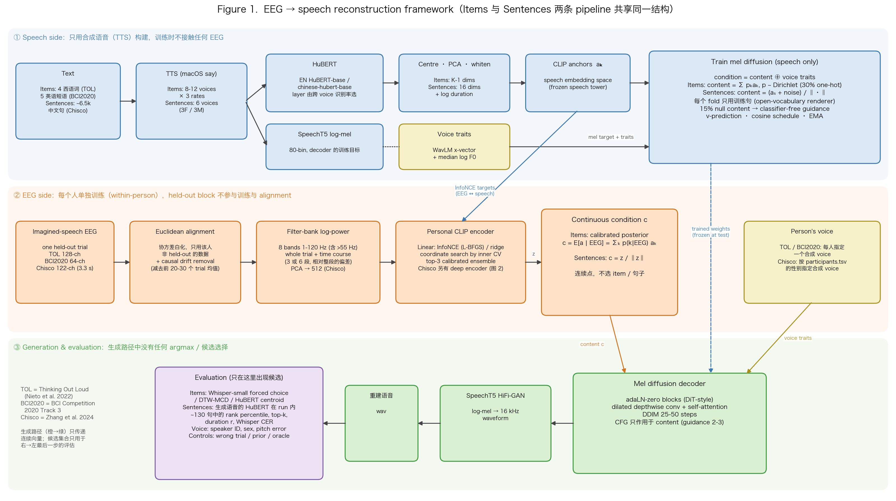
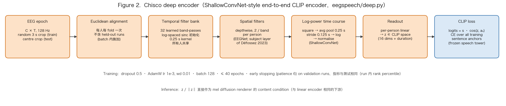

# 3. 模型 framework



Figure 1 是两条 pipeline 共享的整体结构，从上到下分成三个 lane。最上面的 **speech side** 只用 TTS 合成语音构建：文本经过多个 voice 读出后，HuBERT embedding 经 centring、PCA、whitening 得到 CLIP anchors $a_k$，它们定义了一个冻结的 speech embedding space；同一批 clip 的 SpeechT5 log-mel 和 voice traits（WavLM x-vector + median log F0）用来训练 mel diffusion decoder。Decoder 训练时的 content condition 是合成的：items 用 Dirichlet 采样的 posterior 对 anchor 加权平均，句子用加噪声后再归一化的 anchor，并且每个 fold 只用训练句子，因此句子 renderer 是 open-vocabulary 的。这一层在训练时完全不接触 EEG。

中间的 **EEG side** 是每个人单独训练的 encoder。一个 held-out trial 依次经过 Euclidean alignment（只用该人非 held-out 的数据）、causal drift removal、8 个频带（含 > 55 Hz）的 filter-bank log-power（whole trial + time course），再由 personal CLIP encoder 映射到 speech space。Encoder 的训练目标就是上面 lane 的 anchors（InfoNCE，EEG ↔ speech），设置由 inner CV 的 coordinate search 决定，最后做 top-3 calibrated ensemble。Encoder 的输出被转换成一个**连续的 condition c**：items 是 calibrated posterior 下 embedding 的后验均值 $E[a\mid\text{EEG}]=\sum_k p(k\mid\text{EEG})a_k$，句子是 $z/\lVert z\rVert$。这一步不做任何 argmax 选择。

最下面的 **generation & evaluation** 从右往左读：mel diffusion decoder 用冻结的训练权重，接收 content c 和这个人的 voice traits，通过 DDIM 采样（CFG 只作用于 content）得到 log-mel，再经 SpeechT5 HiFi-GAN 输出波形。候选集合（item 词表或 run 内约 130 个句子）只在最后的 evaluation 里出现：Whisper forced choice、DTW-MCD、HuBERT centroid / rank percentile，以及 wrong trial、prior、oracle 三个 control。Items 和 Sentences 在结构上完全相同，差别只在 anchor 的维度（K−1 vs 16 + duration）、encoder 的训练方式（InfoNCE vs ridge / run 内 InfoNCE）、condition 的计算方式（posterior mean vs normalized z）和 decoder 的训练数据（全部 item vs 每折训练句子）。



Figure 2 是 Chisco 上可以替换 Figure 1 中 linear encoder 的 **deep encoder**（`sentences.py --encoder deep`）。它把"filter-bank → spatial filter → log-power time course → linear map"这条链端到端学出来：EEG epoch 降采样到 128 Hz（训练时随机截 3 s，测试时取中间 3 s），按 fold 做 Euclidean alignment；32 个用 log-spaced sinc band-pass 初始化的 temporal filter 由所有人共享；每人每个频带有 2 个 depthwise spatial filter（这是 montage 和头型相关的部分，所以按人单独学习，对应 Défossez et al. 2023 的 subject layer）；平方后在 0.25 s 窗口、0.125 s 步长上平均取 log，得到 band-power time course（ShallowConvNet 的做法）；最后每人一个 linear readout 输出 z。训练用 CLIP loss，speech tower 冻结：logits 为 $s\cdot\cos(z, a_s)$，对所有训练句子的 anchor 做 cross-entropy，并按与测试相同的 run 内 rank percentile 在 validation runs 上 early stopping。推理时 $z/\lVert z\rVert$ 和 linear encoder 一样送入 renderer。实际结果中 deep encoder 的 diagnostic（0.505）略弱于 linear（0.510），见 [02_results.md](02_results.md)。

两张图由 `figures/make_figures.py` 生成，只做绘图，不读取数据：

```bash
.venv-aligned-local/bin/python report/figures/make_figures.py
```
