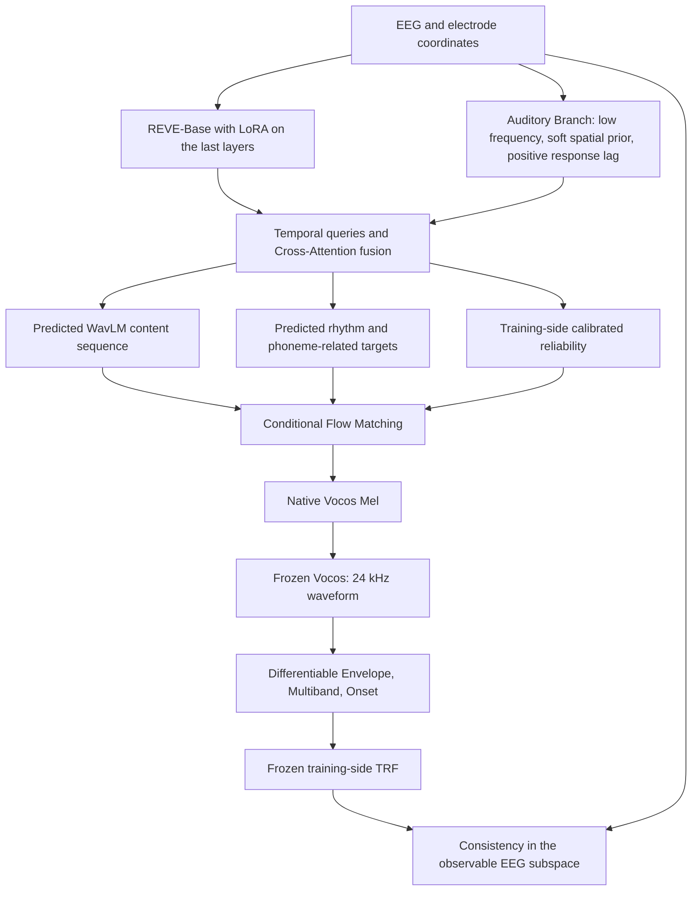

# EEG-to-Speech Research Plan, Improved Version: NeuroSpeech

**NeuroSpeech: Physiology-Guided EEG-to-Speech Generation with Foundation Models**

Provisional working title for the research; not the final paper title. Date: 2026-10-13; version: `neurospeech_plan_v2.1`.

> Translator's note: this is the English translation of the plan. The Chinese original is kept unchanged as [07_neurospeech_research_plan_2026-10-13.zh.md](07_neurospeech_research_plan_2026-10-13.zh.md). Status statements ("not downloaded", "not yet implemented") describe the moment the plan was written, not the current state of the repository.

## Material Passport

- Origin Skill / Mode: academic-research-suite / experiment-agent / plan.
- Basis: the user's requirements for a Foundation Model, physiological alignment, reliability, Simulation and cross-subject learning, plus the newly added Kymata English portion, KaraOne, and the storage constraint of keeping only processed data; the project's v1 documents and public primary sources.
- Source check date: 2026-10-13. Dataset sizes and model interfaces come from the official repositories, authors' data records, model configs and original papers linked below; training parameters and gate thresholds are the starting protocol proposed by this project.
- Verification Status: **PLANNED / UNVERIFIED**. The public sources, the Kymata English directory and file sizes have been checked, and the sizes of the official KaraOne archives were checked via HTTP HEAD; no additional neural recordings or media were downloaded, and no training or data preprocessing was run. The usable paired duration, number of valid subjects, sync error and model performance after download all remain to be verified.
- Version relationship: this file supersedes the research scope and experimental design of the [v1 execution plan](06_execution_plan_2026-10-13.md). The existing code still corresponds to the single-dataset TCN version and must not be marked as implementing this plan.

## 1. Core question and three technical contributions

Core research goal: adapt a general-purpose EEG Foundation Model into a temporal encoder with auditory-task priors, recover continuous English speech while holding out both speech content and subjects, and test cross-dataset transfer.

| Technical contribution | Question to answer | Evidence that must be provided |
|---|---|---|
| Speech-specific EEG Foundation Model Adaptation | Is combining REVE's pretrained representation with an auditory-physiology branch more useful than using REVE directly or a small encoder? | Encoder comparison under a fixed generator; LoRA / physiology-branch ablations; results on genuinely unseen subjects |
| Physiology-guided Cross-modal Alignment | Can timing, rhythm and phoneme-related supervision produce a more usable, calibratable EEG condition? | Local feature alignment, phoneme-boundary diagnostics, reliability calibration, differences between correct and mismatched conditions |
| Neural-consistent Conditional Flow Matching | Can an independently validated auditory forward model constrain the generation trajectory and improve speech content? | Forward-model gate clearance, a fully differentiable trajectory, paired WER improvement from adding the neural term, and condition controls |

Cross-subject adversarial learning and TRF Simulation both enter the training pipeline of the encoder above; each has its own fixed ablation, and neither builds a separate generative architecture. The main generator uses a single CFM, and REVE-Base is the only foundation model.

Stage one is fixed as **Perceived Speech**. Only after real-EEG conditioning shows stable content recovery and condition dependence will an Imagined Speech transfer protocol be designed. This version does not treat perceived-speech results as imagined-speech performance.

## 2. Data fixed to five sources, used in stages by task

**The Perceived stage uses four English EEG sources: ds004408, Brennan2019, the Etard English conditions, and the English portion of Kymata; KaraOne is explicitly assigned to the later Imagined / Articulated transfer stage.** Adding data does not add a new generator route.

### 2.1 Sources, roles and exact definitions

| Dataset | Fixed source | Published size and material | Use in this project |
|---|---|---|---|
| ds004408 | OpenNeuro; keeps the project snapshot `b2d91784a90c18e1d76bd77dcb2b29b0ce27a0be` | 19 subjects, 128-channel BioSemi, 512 Hz; 20 stimulus segments of *The Old Man and the Sea*; word and phoneme TextGrids | Main training, alignment and physiological supervision, cross-subject reconstruction |
| Brennan2019 | NeMAR `nm000180`; the mapping to the original Deep Blue source is retained | Public release has 45 subjects; about 12.4 minutes of *Alice in Wonderland* speech, split into 12 stimulus segments; 60 scalp EEG channels plus VEOG and AUD; 500 Hz | Joint training across the four datasets; held out in its entirety in a separate protocol to test cross-dataset transfer |
| Etard EEG | Zenodo aligned HDF5 version, record `7778289`; original version `7086209` | English session: 18 subjects, 64 channels; English clean, lb / mb / hb, fM / fW conditions; the authors' conversion script records EEG at 1000 Hz | Only English clean is used for paired training; English lb / mb / hb are used for an additional noise-robustness evaluation |
| Kymata Soto Language Dataset, English portion | The Scientific Data paper specified by the user; `english-native-english-conversation/` under OSF `qdzgh` | 20 English subjects; 70-channel EEG recorded simultaneously with MEG, 1000 Hz; the same 400-second English conversation presented repeatedly; word / phoneme time annotations available | Fourth Perceived source, adding natural conversation and another electrode layout; EEG only; overlapping-speech segments are masked according to the locked annotation |
| KaraOne / KARA ONE | The 14 official per-subject archives from the University of Toronto | 14 subjects; 64-channel EEG cap, 1000 Hz; 7 syllable / phoneme prompts and 4 English words; includes prompt, imagined and articulation phases | Later Imagined / Articulated transfer and phonological validation; segmented by true state; must not be mixed into P1 as continuous English auditory material |

The sizes above are as published; the final number of valid subjects is determined by fixed QC. [ds004408 official README](https://raw.githubusercontent.com/OpenNeuroDatasets/ds004408/b2d91784a90c18e1d76bd77dcb2b29b0ce27a0be/README), [Brennan2019 data repository](https://github.com/nemarDatasets/nm000180), [Etard aligned version](https://zenodo.org/records/7778289), [Etard original version](https://zenodo.org/records/7086209), [Etard English session list](https://zenodo.org/records/7778289/files/session_info.json?download=1), [authors' conversion script](https://zenodo.org/records/7778289/files/align_data.py?download=1).

Newly added sources: [Kymata original paper](https://www.nature.com/articles/s41597-026-06579-8), [Kymata official data](https://osf.io/qdzgh/), [KaraOne official description and archives](https://www.cs.toronto.edu/~complingweb/data/karaOne/karaOne.html). Kymata's English material is a continuous conversation among several speakers; a mono file does not mean a single speaker. Before it joins main training, the mask for overlapping speech / segments that cannot be reliably aligned must be determined, keeping normal turn-taking segments. The number of valid scalp leads in KaraOne is checked per file; the 64-channel cap must not be misreported as a fixed 64 valid EEG inputs in every file.

**Subject counts and repeated presentations are not the same as additional independent speech.** Brennan's 45 subjects all listened to the same ~12.4 minutes of material; Kymata English likewise has only the one 400-second conversation. The four Perceived sources nominally total 102 subjects, plus 14 for KaraOne; the final number of valid subjects is reported separately for each stage. Kymata's `sub-E3b` is a second session of E3 and belongs to the same person; it cannot be counted as a 21st subject or placed in a different cross-subject fold. Main results use single-presentation EEG; all repetitions of the same content stay inside the same content split; statistics use the subject as the unit.

Etard v2 clearly distinguishes English and Dutch sessions. This round excludes Dutch, English fragments embedded in Dutch sessions, and the two-speaker fM / fW conditions; lb / mb / hb are interpreted as the babble-noise conditions of the aligned release, and are not replaced by generic Gaussian noise or a uniform SNR.

### 2.2 Batched download, pairing audit, and keeping only processed data

Each source produces an immutable acquisition manifest: source DOI / Git revision, file checksums, true EEG channels and types, sampling rate, units, electrode coordinates, stimulus files, conditions, time mapping, annotation source and license. The weights and code of REVE, WavLM, Vocos, Whisper and the phoneme alignment tool must also be pinned to full revisions and written into a small, trackable model manifest. Raw packages serve only as temporary processing inputs and are deleted per Section 2.4 once verified; source manifests and the necessary small metadata are kept permanently in the processed directory.

The sync audit must be completed per recording:

1. **ds004408:** the official README explicitly states that EEG and stimulus onsets are aligned, so zero offset can be used as a source-backed initial value; evidence of the run ↔ WAV / TextGrid correspondence, duration checks and checks of available events must still be saved. Writing `offset=0`, `drift=0` in a config does not by itself make the per-run audit complete.
2. **Brennan:** use AUD and the real WAV for an audio sync check, and cross-check the EEG timeline of the per-word `events.tsv` against `stim_file`. The continuous `.vmrk` of this re-release does not retain the original segment triggers; do not assume all onsets can be recovered from `.vmrk`. [Official notes](https://github.com/nemarDatasets/nm000180)
3. **Etard:** use the authors' aligned HDF5 and re-verify the condition, part and WAV correspondence; English lb / mb / hb have one second of noise before and after the speech; remove both ends as described in the release notes and record the corresponding shift of the audio time origin. [Aligned-version notes](https://zenodo.org/records/7778289)
4. **Kymata English:** restrict to OSF `english-native-english-conversation/`; take only the FIF / events / channels / coordsystem files of `sub-E*/meg/*_task-en_*` plus the English audio / phoneme / word annotations. Use the audio-repetition triggers on `STI101` and the published timing correction to verify each 400-second interval; triggers, EOG, ECG and MEG do not enter the encoder. During processing, select EEG from the mixed FIF and save its coordinates / time mapping. [English file size and path audit](dataset_storage_audit_2026-10-13.json)
5. **KaraOne:** save the valid prompt order and trial states from `epoch_inds.mat` and `ID.txt` / `ID_p.txt`; align the CNT EEG with the corresponding articulation WAVs; imagined intervals must not be treated as strictly synchronized EEG–Audio pairs with the later real articulation waveform. For EEG-only tasks, do not download, or do not unpack and keep, the Kinect 3D / animation media.

Measurable sync residuals have a target upper bound of 10 ms; anomalous recordings are quarantined for audit. Recordings with only a source statement and no monitoring signal are labeled `source-aligned`; those with independent measured evidence are labeled `measured-aligned`; the evidence level is kept for both. Offset and drift may only be determined from the source and sync signals, never inferred backwards from model scores on the test set.

**AUD, Sound, MIC, EOG, EMG and STIM do not enter the EEG Encoder.** Read channel types first, then select scalp EEG; monitoring audio entering the encoder would be direct audio leakage. Sync signals and events may only be used for pairing / QC.

Unit corrections are audited per data source. The existing numerical-scale correction for ds004408 and the limitation on interpreting absolute µV follow the [unit audit](dataset_unit_audit.json); its `1e-6` correction must not be copied to Brennan or Etard.

### 2.3 Content identity shared by the four Perceived sources

Build the `content_registry` first, then the splits. Content identity comprises the canonical audio timeline, work / passage, narrator, text and repetition version, not merely the file name.

- Checksum the WAVs after decoding, mono conversion and resampling to a common rate; check for resampled versions, volume changes, repeated segments and text overlap.
- The same clean speech and its noisy versions share a content ID; different subjects hearing the same material also share the ID.
- Identical passages across datasets go into the same content group; in particular, check whether English audiobook material overlaps.
- Automatic similarity is used for screening; duplicate mappings must keep the original evidence; shared ordinary phrases do not by themselves merge whole stories.
- **Whether Etard reuses the same speech across conditions has not yet been downloaded and verified.** Before training, a clean ↔ lb / mb / hb correspondence table must be exported, rather than assuming in advance that they are independent.
- All repetitions of the same time slice in Kymata English, including E3's second session, share a content ID; the same sound from another repetition cannot be placed in test as unseen content.
- KaraOne is registered separately using prompt / trial / state identity; repeated prompts and sub-windows of the same trial do not cross splits; it is not mixed with the content groups of continuous speech.

If training material is found to duplicate test material, the split must be revised before formal training, with the reason stated; content groups cannot be moved after test results have been obtained.

### 2.4 Data volume, disk budget, and keeping only processed data

Decimal **GB = 10^9 bytes** is used throughout. Total download size, peak usage during processing, and the final retained size are different measures; sizes that have not actually been preprocessed are explicitly marked as estimates.

| Source | Raw download size and evidence | Scope used this round | Final processed-data budget | Temporary working footprint (plus 5 GB headroom) |
|---|---|---|---|---|
| ds004408 | **20.083 GB**; sum over the local 1946-file acquisition manifest, of which EEG is 19.436 GB | 19 subjects, 20 English stimuli | **10–11 GB, estimated** | About 1–2 GB extra per recording; a complete raw copy and a complete processed copy are not held at the same time |
| Brennan2019 | **About 3.8 GB**; NeMAR/EEGDash catalog size, not measured file by file | 45 subjects, EEG / AUD sync and 12 audio segments | **2–3 GB, estimated** | About 1–2 GB extra per subject; after the raw AUD check only the sync record is kept |
| Etard | **About 21.1 GB** release package: eeg.zip about 19.2 GB, audiobooks.zip about 1.9 GB | Keep only processed EEG / audio for English clean and lb / mb / hb | **3–8 GB, estimated** | If the whole package must be downloaded, reserve an extra 25–30 GB; process HDF5 members one at a time without fully unpacking all languages / conditions |
| Kymata English | **117.767 GB**: English-task FIFs and the selected audio / sidecars counted file by file; of this, 81 mixed FIFs are 117.609 GB, largest single file **1.616 GB** | Strictly limited to the English directory and task-en; keep EEG only | **5–6 GB, estimated** | Download → process → delete one run at a time, working footprint about 3–4 GB; the 117.767 GB is never on disk at once |
| KaraOne | **24.824 GB**: sum of HEAD Content-Length over the 14 official tar.bz2 files; largest single archive **2.406 GB**; the website overview says about 24 GB | Only EEG, the required WAVs, and prompt / trial / state / electrode metadata | **2–3 GB, estimated** | One subject archive at a time, about 4–8 GB recommended; selectively extract CNT / labels / WAV, skip the large Kinect files |

Evidence: [this round's storage audit](dataset_storage_audit_2026-10-13.json), [Brennan catalog size](https://eegdash.org/api/dataset/eegdash.dataset.NM000180.html), [Etard official file sizes](https://zenodo.org/records/7778289), [KaraOne official archives](https://www.cs.toronto.edu/~complingweb/data/karaOne/karaOne.html). The Kymata size comes from the public file metadata of the OSF English directory and excludes Russian, MRI, visual frames, empty-room and MEG-only calibration files; it is not the size of the whole OSF project.

**The Kymata English download whitelist has been checked:** the root path is `english-native-english-conversation/`; the public directory contains `sub-E1`–`sub-E20` and `sub-E3b`; keep the FIFs and small sidecars needed for all English task-en logical runs, plus the audio and text annotations under `stimuli/audio/`. The blacklist is `russian-native-russian-conversation/`, `anat/`, `stimuli/visual/`, `task-emptyroom` and MEG calibration files. The "download the whole project, then delete the Russian part" approach is not used.

A FIF packages EEG and MEG together; at the server file level, selecting channels cannot download only the EEG bytes. The selected English FIF must be read temporarily, the EEG extracted, and the source FIF then deleted. If a logical run has split files, verify the complete set of parts before processing; the working footprint is the sum over all parts of that run.

The processed-size estimate uses the following baseline: keep 200 Hz float32 EEG and 64 Hz float32 low-frequency EEG; with duration T and C valid channels, the upper bound of the arrays is about `T×C×(200+64)×4 bytes`, plus shared audio / labels / receipts. For ds004408, the raw EEG bytes and the 264/512 rate ratio give about 10.02 GB; for Kymata, published durations and 70 channels give about 4.9 GB, reserved as 5–6 GB. KaraOne's Imagined stage does not need stored auditory TRF targets, so only the 200 Hz base EEG needs to be kept. QC, cropping and lossless compression can reduce size, but no compression ratio is assumed in advance; Etard must be re-estimated after the first English subject is processed.

**Only these processed materials are kept long term:**

- `data/processed/neurospeech/{dataset}/base/`: continuous EEG, or trial shards with support regions, after source-unit calibration and fixed filtering / resampling; stored in physical units, not duplicated per fold, and not mixed in advance with test statistics.
- For English audio, each canonical content keeps a single 24 kHz mono lossless processed audio file usable for targets and scoring; the clean / noise audio that is needed is registered separately. The 16 kHz teacher input is resampled on demand; no second full set of WAVs is stored.
- The necessary small copies of raw events; trial / state / split / content identity; channels / coordinates / masks; annotations and their quality; time transforms; source file URL / revision / SHA256; preprocessing parameters and the processed SHA256.
- All 60-second calibration blocks are **processed separately, within budget,** while the raw input still exists, using only the filtering / context of those 60 seconds; dedicated processed calibration shards are saved. After raw is deleted, one cannot cut 60 seconds out of a whole-run filtered result that borrowed information from outside the interval and claim the calibration budget is met.

**Cleanup order:** first freeze the processing parameters and content / calibration intervals; download and verify one run or subject archive at a time; process in a temporary directory; reopen the output and check shape, channels, duration, time mapping, finite values, sync / QC, and audio and annotation correspondence; confirm that the official reader can read samples relying only on processed data; after atomically publishing processed data and the receipt, immediately delete that batch's archives, raw CNT / FIF / EEG / HDF5, unneeded media and temporary intermediate arrays, then continue with the next batch. On failure, keep the current batch's source input and the error record, and clean up only after the fix; never leave an empty processed output while the only input has been deleted.

The verification here only checks the data contract and preprocessing; it does not run training or open the model's final test performance. Keeping small source metadata is part of the reproducibility record; large raw samples are not kept on disk permanently. If source processing such as filtering / QC changes later, the corresponding source files must be downloaded again according to the receipt.

The existing, verified ds004408 raw files can enter this batched flow directly without being downloaded again; they are released batch by batch only after the v2.1 processed read contract and the dedicated calibration-block checks are complete. The current v1 commands that depend on raw must be migrated first; raw cannot be deleted while the old entry points remain in use.

**Caches and models also limit disk use:** the 1–8 Hz auditory-branch input is derived online from the processed base signal over the support region, with no third full copy of the EEG stored; windowing stores only indices, not copies of overlapping EEG windows; WavLM / Mel are cached only by unique content and crop ID and shared by all subjects; P1/P2, folds and OOF share the read-only processed base, while fitted statistics and checkpoints are isolated. The large REVE token cache uses a capped LRU or is not written to disk; 18 full copies of the data are not generated.

Uncertainty OOF saves only per-frame error summaries, predicted variances and sample IDs, not full copies of the 768-dimensional predictions; the TRF covariance is accumulated in a streaming fashion; Simulation residual blocks are computed on demand from the processed neural targets and the corresponding OOF forward model, with a hard cap on the cache, and full residual EEG is not duplicated per fold / seed. These limits must be part of the reader and cache implementation, so that derived caches do not fill the disk again after the processed data has become smaller.

The processed-data budget for the five sources totals **about 22–31 GB**; the four Perceived sources take about 20–28 GB first, and KaraOne is downloaded when the transfer stage arrives. Shared teacher cache capped at 2–4 GB, public weights about 3–5 GB, main model / current resume checkpoints 4–6 GB, listening samples and reports about 1–2 GB; the long-term working set is planned at about **32–48 GB**. These model / cache figures are budgets and need to be updated from first-batch measurements.

With the batched mode above, Kymata does not add 118 GB of resident usage. The Etard whole-package path can still push the peak to about 60–80 GB; if the server supports reliable ZIP Range reads, only the target members can be fetched to lower the peak; otherwise space for the whole package must be reserved, and one must not pretend that eeg.zip can be partially downloaded by English condition. Before each batch download, free space must be ≥ that batch's source package + the members to be unpacked + the new processed output + at least 5 GB headroom; if it is not, stop that batch and do not start full concurrent downloads. The directory cleanup log records the space actually released.

When finished, the raw temporary directory is empty and the resident data is only processed base / labels / provenance; regenerable teacher and REVE caches are evicted according to budget. The complete REVE pretrained weights are stored only once; checkpoints store only LoRA and the new modules; completed runs keep the best checkpoint and metrics; optimizer state is kept only for the few runs that currently need to resume.

## 3. Two experimental protocols, each trained and frozen separately

### 3.1 P1: joint training on the four Perceived datasets, internal double hold-out

ds004408, Brennan2019, Etard clean and Kymata English are trained jointly, using clean English, alignable audio segments with a single active speaker; Kymata allows normal turn-taking, and reliably annotated overlapping-speech segments are excluded from main training. The four sources use a fixed content split and five subject test folds.

**Content split:** group preferentially by complete stimulus segment, about 70% / 15% / 15% into train / validation / test, with each source keeping at least one validation and one test content group. Small sources are adjusted by whole groups and the actual ratio is reported; material is not cut into random adjacent windows to hit the ratio. ds004408 keeps audio01–14 / 15–17 / 18–20 as long as cross-source deduplication produces no conflict; the specific IDs for Brennan and Etard are generated with fixed seed=20261013 after the data audit and then frozen; this document does not pretend to have inspected all of their files.

Kymata has only one 400-second audio; fixed content blocks of about 60 seconds are built on the canonical audio time, with full guards at the boundaries; all subjects / repetitions / E3's second session follow the same block split. Word, phoneme and speaker-overlap masks are also registered on this timeline; different repeated runs cannot be treated as different stimuli.

If a source has too few canonical stimuli, use predefined contiguous content blocks rather than random windows. Exclude at least 10 seconds on each side of a block boundary; the support regions of the complete filtering, REVE full-window attention, teacher context and acoustic annotations must all belong to the same block. Report that the evaluation in this case is of unseen segments within the same story.

**Subject split:** sub-001–003 of ds004408, 5 subjects from Brennan, 2 from the Etard English session and 3 from Kymata English are fixed as development-validation subjects; the latter three groups are generated from the real rosters with the fixed seed. Kymata merges E3b into E3 before splitting; all sessions / runs / repetitions of the same person cannot cross folds. The remaining subjects are divided into five groups balanced by source; the current fold excludes the development subjects and the test subjects.

| Use | Subjects | Content |
|---|---|---|
| Formal fitting | Training subjects of the current fold | train content |
| Checkpoint / hyperparameter selection | Fixed development subjects | validation content |
| TRF physiological gate | Training subjects of the current fold | validation content; scoring only |
| Final main test | Test subjects of the current fold | test content |

Each non-development subject contributes their own held-out result exactly once. All normalization, reliability calibration, TRFs, residual models, center-subject selection and simulation noise statistics come only from the training portion of the current fold.

### 3.2 P2: Brennan2019 held out entirely as an external set

P2 trains on ds004408 + Etard clean + Kymata English; Brennan as a whole takes no part in development. The source-side train / development split follows the fixed content rule; all source-side non-development subjects are used for training, and the five target-side folds are not run. KaraOne does not enter this Perceived protocol.

**P2 must build an independent pipeline again from the original public pretrained weights.** Encoders, CFMs, oracles, TRFs, reliability calibrators and statistics that P1 has trained with Brennan cannot be used to initialize P2. The speech oracle also uses only P2 source-side training audio; before the external evaluation, Brennan target audio is not used to pretrain the generator.

The external test includes two pre-declared results:

- **Zero-shot:** all Brennan subjects that pass QC use the frozen source model, source-side scaling statistics and the real montage. No fitting of Brennan whole-session mean, variance, reliability or TRF, and no re-selection of the model.
- **60-second supervised calibration:** each person uses only a pre-specified 60 seconds of continuous EEG and the corresponding known speech to update a small Adapter. The final test for all target subjects excludes the same calibration content pool and its context guard, so both results are compared on the same test content. The calibration pool is determined by metadata and cannot be picked by results.

All thresholds and Adapter settings for the external test are locked on the source-side development set. First complete P2 source-side development and lock the common architecture, losses and stopping rules; then carry out P1 development, which includes Brennan; effects observed on Brennan in P1 cannot be used in reverse to choose the P2 configuration. Subjects lacking a complete calibration block still enter zero-shot, and few-shot is reported as missing. Brennan has limited material from a single story; external success supports one independent lab / corpus transfer and cannot be equated with generalization to arbitrary stories, languages or narrators.

The corpus overlap of public pretraining such as REVE must also be audited. If it cannot be ruled out that the Foundation Model saw the target source during unlabeled pretraining, write explicitly "held out entirely from downstream training; pretraining overlap unknown", and do not claim that the target EEG was never seen by any pretrained model.

### 3.3 Etard noise evaluation

The evaluation is fixed to English lb / mb / hb, with the corresponding clean attended speech as the target. All noise versions share content identity, subject folds and splits; training uses clean only. Where corresponding clean EEG exists, compute same-subject / same-content clean→noise paired differences; otherwise report as missing.

Label "noise transfer on content seen in training" and "noise transfer on test content" separately; the latter is the main robustness result. Noise conditions are not used for training, checkpoint selection or SNR-specific adaptation. Report the original condition labels and any verifiable SNR; do not guess numerical values for lb / mb / hb.

Scoring also lists free ASR on both the clean target and the noisy waveform actually presented, to show the intelligibility of the auditory input itself; these two kinds of audio only enter offline scoring, not EEG-conditioned inference.

## 4. Common time interface and preprocessing

| Object | Fixed starting setting |
|---|---|
| EEG main input | Source unit audit; scalp EEG; CAR over valid leads; 0.5–40 Hz; resampled to 200 Hz |
| Auditory branch | 1–8 Hz extracted from the same physical EEG, keeping the true time origin; resampled to 200 Hz |
| TRF / neural target | The main signal additionally low-passed at 15 Hz and resampled to 64 Hz |
| EEG layout | Real coordinates or a sourced standard montage; Perceived sources keep C=128 / 60 / 64 / 70, with the specific valid leads checked per file |
| Normalization | Shared scaling statistics fitted on source-balanced training EEG; a shared scalar scale across layouts; must not require test-channel statistics for a new layout |
| Core audio window | 4 s; training stride = 2 s; validation / test stride = 4 s |
| EEG context | Audio core [a,a+4] corresponds to EEG [a−1,a+5.5], 1300 points at 200 Hz |
| Audio teacher | 16 kHz, audio crop [a−1,a+5]; keep the WavLM frames inside the core |
| Generated audio | 24 kHz, Vocos native 100-bin log-Mel; fixed 4 s |
| Boundary | Default guard ≥ 10 s; enlarged and re-recorded when the actual FIR / resampling support is longer |

Use offline zero-phase FIR; every kernel, resampler support length and boundary-extension method is written to the preprocessing manifest. Process each content block independently; boundary reflection cannot borrow real EEG from another split. REVE can see the full 6.5 s crop, so even with a positive response-lag window this is still offline reconstruction and cannot be called real-time.

The starting QC thresholds are carried over: within the 4 s core, flat std<0.1 µV, peak-to-peak>400 µV or non-finite values are marked abnormal; more than 10% abnormal leads rejects the window; a training rejection rate above 20% first triggers an audit of source units and recording format. Thresholds are locked after the unit interpretation has been confirmed on the training side and cannot be relaxed for test data. Existing bad-channel annotations always apply.

For REVE, use the valid electrodes and their coordinates: different layouts go into separate buckets; samples with different bad-channel sets can be independent microbatches with accumulated gradients. AUD, missing electrodes or bad channels must not be filled in as "real valid electrodes". If padding is implemented, the attention mask must truly enter REVE's attention computation, not merely multiply the input by zero.

Each sample stores the raw EEG sample range, audio range, time transform, content ID, subject ID, condition, channel mask, coordinate source, annotation confidence, split and all versions. Output the number of valid subjects, the independent audio duration, accepted / rejected window counts and the weights of the different sources.

## 5. Model: REVE + Auditory Branch + a single CFM

Real audio provides WavLM / acoustic / phoneme targets only during training and offline scoring. The inference interface receives only EEG, the real electrode positions, the mask, the fixed window length, the model and the noise seed.

### 5.1 Speech-specific REVE Adaptation

The backbone is fixed to `brain-bzh/reve-base`, about 69.2M parameters, 200 Hz input. The authors' public config has 22 layers, hidden=512, patch_size=200, patch_overlap=20, so a native patch covers 1 second with a 0.9-second stride; the output keeps the channel / time structure `[B,C,N_patch,512]`; averaging over the whole sentence and then pretending to recover high temporal resolution is forbidden. [Model card](https://huggingface.co/brain-bzh/reve-base), [official config](https://raw.githubusercontent.com/elouayas/reve_eeg/main/hf/reve-base/config.json), [official forward](https://raw.githubusercontent.com/elouayas/reve_eeg/main/hf/reve-base/modeling_reve.py)

First train the temporal readout with all REVE weights frozen; then insert LoRA only into the attention `to_qkv` and `to_out` of the last 4 Transformer blocks, rank=8, alpha=16, dropout=0.05, with the original weights frozen. The official implementation uses a fused QKV projection, so LoRA has to be attached to the real modules; the nonexistent `q_proj` / `v_proj` names cannot be used.

The true center time of each patch is passed to the temporal readout together with the original electrode coordinates. 50 Hz queries read information from neighboring patch tokens and are fused with the fine-grained sequence of the Auditory Branch; fine-grained information comes mainly from the latter, and patch interpolation is not interpreted as new 20 ms neural observations. All coordinate transforms follow the coordinate convention of the pinned REVE, keeping the distinction between measured and template positions.

REVE's pretraining and this project's speech-specific adaptation are named separately. This project does not retrain a general EEG Foundation Model on these few limited corpora.

### 5.2 Auditory Physiological Encoder

A single lightweight branch is fixed, hidden=128; the temporal backbone is 6 double-convolution residual TCN blocks, kernel=3, dilation={1,2,4,8,16,32}, LayerNorm, dropout=0.1.

- **Low-frequency speech tracking:** the input is 1–8 Hz EEG, keeping the variations related to envelope / rhythm.
- **Response lag:** at audio time t, query EEG time t+δ, δ={0,50,100,200,300,500} ms; the weights are a softmax learned in training. This window represents the post-stimulus response; the opposite sign t−δ must not be used.
- **Soft spatial prior:** an attention bias is built from the distance of each electrode to the template positions Fz, Cz, T7, T8 and POz; its strength is initialized small and is learnable. All valid scalp electrodes can still be selected; scalp coordinates are not treated as a precise localization of auditory cortex.

At 200 Hz the theoretical receptive field of this TCN is 253 points, about 1.265 s; the 1.5 s right-side context covers its half receptive field plus the maximum 0.5 s response lag. Any additional fusion layer must be checked for whether it enlarges the required context.

### 5.3 Fusion and temporal heads

Fixed as **Auditory temporal queries → Cross-Attention over REVE tokens, followed by gated residual fusion**, fusion width 256, 4 heads, 2 layers. It keeps both the pretrained context and the local auditory sequence; the two branches cannot simply be averaged.

After fusion the outputs are: a 768-dimensional WavLM mean sequence, an envelope / onset rhythm sequence, phoneme-boundary and phonological-feature probabilities, and two kinds of reliability (content and rhythm). The phoneme head is auxiliary supervision only; no target phoneme string or real timestamps are input at generation time.

The related 2026 speech benchmark compares LaBraM / EEGMamba with CNNs on overt / imagined classification; it does not directly test REVE or this project's perceived continuous generation. It is therefore used only as motivation that "pretraining transfer needs to be validated", and cannot be the basis for claiming that REVE has been shown to be ineffective. [Original benchmark](https://arxiv.org/abs/2607.27268)

## 6. Multi-level Neuro-Acoustic Temporal Alignment

### 6.1 Fixed speech targets

1. **WavLM:** frozen `microsoft/wavlm-base`, output of the 6th Transformer block, 768 dimensions, 16 kHz audio. Convolution stride=320, receptive field=400 samples, nominal frame interval 20 ms; frame centers are computed from the actual convolution parameters. [Official config](https://huggingface.co/microsoft/wavlm-base/blob/main/config.json)
2. **Envelope / onset:** 25 ms RMS, positive part of the adjacent-frame difference, 64 Hz. Smoothed envelopes of 8 fixed frequency bands are also extracted for the TRF; no separate acoustic teacher is trained.
3. **Phoneme-related targets:** prefer the existing TextGrids of ds004408; Brennan / Etard use the source text and the same frozen English forced aligner, mapped uniformly to phoneme boundaries and a fixed phonological feature table.

The new annotation tool is fixed to the MFA `english_us_arpa` acoustic / dictionary pair, with version and file checksums written to the manifest; different English accents need quality checks. [MFA official usage](https://github.com/MontrealCorpusTools/Montreal-Forced-Aligner/blob/main/docs/source/first_steps/index.rst), [model scope](https://huggingface.co/MontrealCorpusTools/english_us_arpa)

Do not assume Etard already provides complete, usable text: check the source first and build verified transcripts for the missing parts. Automatic ASR can be used for a first draft, but the final WER reference cannot be taken directly from the output of the same ASR used for scoring. New phoneme annotations are checked on the training / development side by sampling at least 200 boundaries per source, reporting the error distribution and the valid coverage; low-quality intervals mask the phoneme loss. Test annotations are used only for scoring after the lock, never for training or model selection.

### 6.2 Alignment loss

\[
\mathcal L_{\mathrm{align}}=
\mathcal L_{\mathrm{feature}}+0.1\mathcal L_{\mathrm{contrast}}
+0.2\mathcal L_{\mathrm{rhythm}}+0.05\mathcal L_{\mathrm{phoneme}}.
\]

- `L_feature = SmoothL1(μ,H_A) + 0.5·(1−cosine(μ,H_A))`, using per-dimension scaling statistics of the training audio and a valid-frame mask.
- `L_contrast`: symmetric multi-positive InfoNCE over 1-second local representations, temperature=0.07. EEG from several subjects for the same content / time are positives; repeated content and overlapping neighboring windows cannot be negatives; negatives are matched by content and duration.
- `L_rhythm`: MSE of the standardized envelope / onset, plus `1−Pearson r` of the envelope; when the effective variation is close to zero only the regression term is computed.
- `L_phoneme`: weighted BCE on phoneme boundaries plus BCE on phonological features; weights / class statistics come from the training side and are masked by annotation quality; word-level onsets are not passed off as reliable phoneme ground truth.

Every term is first averaged over the number of valid frames / features. The weights above are starting values; gradient norms on real samples are recorded, and during source-side development at most one pre-registered magnitude adjustment is allowed, after which the comparable settings of all systems are frozen. The raw values of the four un-normalized losses cannot be compared directly.

## 7. Reliability-aware Conditioning

Each time slice outputs the speech-feature mean μ_t and one log-variance s_t each for content and rhythm. The reliability head takes the fused representation as input, but its error target is provided by training-side prediction error; at inference, real audio features, residuals or target text cannot be input.

Uncertainty is supervised with the detached, standardized prediction error:

\[
\mathcal L_{\mathrm{var}}=\tfrac12\left[
e_t\exp(-s_t)+s_t\right],\quad
e_t=\operatorname{stopgrad}\left(\operatorname{mean}_d(\mu_{t,d}-H_{A,t,d})^2\right).
\]

The rhythm branch uses the same definition. The head input is stop-gradiented so that the uncertainty objective does not rewrite the content representation; the variance is limited to [1e−4,10] on the standardized error scale.

**Calibration must come from training-side out-of-fold predictions:** within each formal training set, form three folds grouped by subject / content; the k-th replica excludes the corresponding subject group and content group from training and predicts on the doubly held-out training-side intersection. A monotonic log-variance calibration map is fitted on these OOF errors, and the calibrator is then fixed for the encoder trained on the full training set. B1 / B2 training uses `L_align+0.05L_var` together; the OOF replicas repeat the same B1 / B2 schedule, and all of their normalization, TRF, center selection and simulation statistics must also exclude the corresponding held-out group. OOF replicas are a calibration cost and must be counted in the compute budget.

The reliability input of the CFM is defined as `R=1/(1+calibrated_variance)`, gating content and rhythm separately. Training and inference both use the same head, computable from EEG; one cannot gate with the true error in training and switch to the predicted error at test time.

The reliability check reports error rank correlation, calibration curves, risk–coverage and source-stratified results, and compares against constant variance. The development gate requires that the CI lower bound of the variance–error Spearman correlation under a subject-grouped bootstrap is > 0, and that the Gaussian NLL is better than the training-side constant variance; if this is not met, gating is frozen to neutral and the failure is reported; reliability must not be used to mask hard examples in order to improve overall metrics.

In the generation stage the aligned encoder, heads and calibrator are frozen, preserving the error distribution to which the reliability corresponds. All generator-side training updates only the CFM; this keeps the conditions of S2 / S3 exactly the same, so the main comparison directly tests NC. The 60-second Adapter changes the condition distribution of the target subject; few-shot reliability merely carries over the source-side estimate, its calibration diagnostics must be reported separately, and it cannot be claimed to provide error calibration for new subjects automatically.

Additional condition diagnostics: correct EEG, wrong-time EEG, null, and shuffling the content condition while keeping the correct rhythm / reliability. This checks whether reliability has merely learned loudness, source or difficulty. All samples enter the primary WER; reporting only the high-reliability subset is not allowed.

## 8. Neural-consistent Conditional Flow Matching

### 8.1 A single generator and condition interface

A linear noise→data CFM path is used:

\[
M_\tau=(1-\tau)z+\tau M,\quad z\sim\mathcal N(0,I),\quad
\mathcal L_{\mathrm{FM}}=\mathbb E\|v_\theta(M_\tau,\tau,c_E)-(M-z)\|^2.
\]

The base formulation follows Flow Matching; the novelty is concentrated in the conditioning and the neural constraint. [Original paper](https://arxiv.org/abs/2210.02747)

The CFM is fixed as a 6-layer time-conditioned Transformer, hidden=256, 4 heads, AdaLN time injection, with a target of ≤15M trainable parameters, locked after the actual count. All systems use the same network:

- Content condition: the predicted WavLM sequence enters the Mel tokens through Cross-Attention.
- Rhythm condition: the predicted envelope / onset is interpolated to the Mel grid by true time and acts as a low-frequency local residual modulation.
- Reliability: modulates the two information pathways above separately; baselines with a neutral value keep the same interface.
- Null condition: 10% of training samples have the content / rhythm conditions nulled together; formal inference uses guidance=1.

The target Mel must use the native feature extractor of the frozen `charactr/vocos-mel-24khz`: 24 kHz, 100 bins, n_fft=1024, hop=256, center padding; the natural log of the magnitude Mel. Mel-bin scaling is fitted on the training side and undone before decoding; 4 seconds is normally 376 frames, with the shape of the native front-end taking precedence. [Vocos config](https://huggingface.co/charactr/vocos-mel-24khz/blob/main/config.yaml), [native front-end](https://github.com/gemelo-ai/vocos/blob/main/vocos/feature_extractors.py)

Formal sampling is fixed to 32-step Heun with generation seeds 0, 1, 2; metrics are averaged within the window and the best sample is not picked. The initial state is pure noise; inference needs no real Mel, WavLM, text, word count or true sentence length.

**Operational definition of the fixed voice (timbre) condition:** all samples use the same learnable style token, dimension 128; it is learned only in the training-audio oracle stage of the corresponding protocol and then frozen. The condition does not depend on the subject or on test audio. This round still supervises with the real native Mel, so the fixed token by itself cannot guarantee that all outputs have been converted to the same narrator; "the condition is fixed" and "the actual timbre is identical" are reported separately. The primary endpoint is content; additional speaker similarity is not a success criterion.

The time-conditioned generator / ODE design of NeuroSonic can be borrowed; its official code and checkpoint are released; the feature interface and training sources of the pretrained model differ from this project, so it cannot be used directly as this round's oracle without a compatibility / overlap audit. The main experiments uniformly initialize from an oracle trained on this protocol's training audio. [MICCAI paper](https://papers.miccai.org/miccai-2026/0711-Paper4295.html), [authors' code](https://github.com/Y-Research-SBU/NeuroSonic), [public checkpoint](https://huggingface.co/Y-Research-Group/NeuroSonic)

### 8.2 Auditory Forward Model and the observable subspace

Fitted separately for each source and each training subject of the current fold:

\[
F_s(\phi(A))(t)=b_s+\sum_{\delta=0}^{500\mathrm{ms}}W_{s,\delta}\phi(A)(t-\delta).
\]

The input φ is the broadband envelope, the 8-band envelope and the onset, all at 64 Hz; the output is that subject's low-frequency EEG. Band edges, envelope smoothing and scaling are determined only by the training protocol.

Fit with mTRFpy ridge, lag=0…500 ms, λ candidates={0.01,0.1,1,10,100}; pin the package version and its ridge scaling convention. Nested grouped cross-fitting: the inner loop selects λ, the outer loop produces predictions for content that was truly never fitted, used to select P_s and estimate residuals; one cannot tune λ repeatedly on the same OOF output and then claim independent validation. [mTRFpy official documentation](https://mtrfpy.readthedocs.io/en/stable/basics.html)

When there are too few content groups, the TRF uses guarded contiguous 60-second blocks inside training; this happens only within the train content and does not change the main train / validation / test split.

`P_s` is fixed as the channel subspace confirmed to be predictable by the training OOF: r>0, 500 circular-shift controls of ≥2 seconds, masking of concatenation boundaries, BH-FDR q<0.05; at most 32 channels. The training OOF residuals in this space are used to estimate the shrinkage covariance Σ_s, with an eigenvalue floor of 0.1 of the standardized variance. P_s, Σ_s, λ and the TRF are then frozen.

The independent gate target is carried over: in each source at least 80% of training subjects have ≥8 qualifying channels; the across-subject median of the mean r on unseen validation content is ≥0.05; and the lower bound of the 95% CI of the subject-paired advantage of the correct correspondence over time-shifted / mismatched is > 0. These are this study's thresholds, not results already obtained.

The neural-loss mask of subjects who do not qualify is zero, but they continue to take part in real-EEG alignment / FM training. If a source fails as a whole, report that source's neural-term coverage as zero rather than hiding it; the content-alignment experiments of S2 can still be completed. Whether the claim of a complete four-source neural constraint holds is determined by the actual gate coverage.

### 8.3 The neural term must constrain the full generation trajectory

\[
\hat A=\operatorname{Vocos}\left(\operatorname{denorm}
(\operatorname{CFM\_rollout}(z,c_E))\right),
\]

\[
\mathcal L_{\mathrm{NC}}=
\operatorname{mean}_{\mathrm{valid}}
\left[P_s(F_s(\phi(\hat A))-E_{\mathrm{low}})\right]^T
\Sigma_s^{-1}
\left[P_s(F_s(\phi(\hat A))-E_{\mathrm{low}})\right].
\]

φ uses differentiable RMS / onset / multiband operations, whose filtering must agree numerically with the NumPy / mTRF fitting front-end. The comparison is over the 0.6–3.9 s valid region of the real core EEG.

When a window has bad channels, use only the intersection of `P_s` with the window's valid channels and invert the corresponding sub-matrix of the residual covariance; a mask cannot simply be multiplied onto the full vector after whitening. With fewer than 4 valid qualifying channels, the NC term of that window is set to zero; normalize by valid time and dimension, and report the actual trigger coverage.

Every 4 ordinary updates, take microbatch=1 from qualifying training subjects, start from independent pure noise and do a complete rollout with 8-step Euler; activation checkpointing keeps GPU memory under control. λ_NC rises from 0 to 0.1 over CFM training updates 5k–10k and is fixed afterwards. Content, rhythm and reliability are all detached; both the ordinary FM and the extra NC branch update only the CFM; the encoder has already been adapted in B1 / B2.

Freezing the Vocos parameters is not the same as disabling input gradients. The training wrapper calls the frozen backbone / head directly, bypassing the inference-mode wrapper of the authors' decode; the Mel is not detached and no_grad is not applied to the whole chain. It must be verified that the `NC→waveform→Mel→CFM` gradient is nonzero and finite and that the frozen networks receive no parameter gradients. [Vocos decode implementation](https://github.com/gemelo-ai/vocos/blob/main/vocos/pretrained.py)

The primary neural term cannot be computed from an M_τ that contains the real Mel, nor from a one-step back-estimate. Record the development difference between the 8-step training trajectory and 32-step sampling; a drop in the TRF score does not automatically mean a WER improvement.

New subjects seen only at test time have no training-side TRF. The main results cannot fit a separate scorer for test subjects; the neural-consistency metric comes from the independent diagnostic on "training subjects × unseen validation content".

## 9. TRF Simulation: only to strengthen auditory robustness

\[
E_{\mathrm{sim}}=F_s(\phi(A))+\epsilon_s.
\]

The simulator uses only the current training subjects, training audio, training TRFs and cross-fitted residuals. Residuals are resampled in contiguous blocks, preserving temporal / spatial correlation, and cannot be replaced with arbitrary white noise; the perturbation range is bounded by the training subjects' gain, lag, spatial mixing and observed artifact statistics. The generation seed, original source and simulation parameters are saved.

An auxiliary mix of 80% real and 20% simulated samples is used, with a starting simulation-loss weight of 0.1. **Simulated samples only supervise the rhythm head and the consistency of the rhythm representation; they take no part in WavLM content regression, the phoneme loss or the real EEG–Audio contrastive term.** Merely binding a low-frequency TRF-synthesized signal to a piece of audio and then requiring it to recover the full WavLM features would mistake an artificial training association for real neural semantics.

Real data carries the main content training; simulated data must not come from held-out content, even if the audio itself is public. The individual TRFs of test subjects cannot be simulated. The effect is judged by a paired ablation of "real training" versus "real + simulated training" on unseen real subjects.

The retention rule for Simulation is fixed: over three training seeds on the real development set, the source-equal-weighted WavLM error decreases by ≥2% on average, and no single source's error increases by >5%. The P2 decision uses the source side only; P1 decides independently, and the different variants are recorded. If the rule is not met, simulation mixing is stopped in the main model and the real-training results and the negative ablation are kept; the other models continue, and no new simulation architecture search is started. Improvement on the noise test is evaluated after freezing and is not a tuning basis for retaining Simulation.

## 10. Cross-subject: GRL and centered-progressive curriculum

Cross-subject training acts directly on the fused, shared EEG representation. The C-SA of SAM-Net provides the methodological motivation, but its original task is EEG-to-Video; the speech training schedule below is an explicit adaptation and does not claim to have reproduced or validated the original as is. [CVPR original paper](https://openaccess.thecvf.com/content/CVPR2026/html/Han_Cross-Subject_EEG-to-Video_Reconstruction_and_Beyond_CVPR_2026_paper.html)

1. **Stabilize the content representation first:** all training subjects jointly complete the real-data alignment warmup, without GRL.
2. **Add the subject adversarial head:** apply mask-aware temporal pooling to the fused sequence and predict the training-subject ID; there is one classifier within each source, and identity information is reduced through GRL. A classifier in which source and subject correspond one-to-one cannot be treated as pure subject removal.
3. **Determine the center:** within the same source, on the same training stimuli / time anchors, compute the representation distances between training subjects and choose the medoid. Similarity of averaged representations of different stories cannot be used for ranking, and test subjects can never be used to choose the center.
4. **Progressively organized sampling:** by distance to the center, the nearest 25% → 50% → 100% of training subjects form the main sampling pool; each stage keeps 20% replay over all training subjects; P1 is balanced over four sources, P2 only over the three source-side sources. The center is not the only training target.
5. **GRL schedule:** enabled after the first 10k updates of LoRA adaptation, then raised from 0 to 0.05 over the next 10k. If the development WavLM error is worse than before enabling by >10% on two consecutive validations, the cap may be halved once only, to 0.025; if this triggers again, GRL is stopped and the failure recorded. The rule is frozen in advance on the source side and cannot be adjusted after testing.

Each batch is balanced first over sources, then over real subjects and content, so that Brennan's larger subject count does not drown out the other sources. The adversarial loss is used only for real samples; Simulation has no new subjects that could serve as real identity labels.

Zero-shot uses the shared model. Few-shot updates only a zero-initialized residual Adapter placed after the fused representation and before the task heads, 256→16→256, about 8.5k parameters; backbone / LoRA / heads / CFM / reliability calibrator are all frozen.

The calibration budget is 60 seconds of real continuous EEG, with filtering and model context all counted; the block is filtered on its own and interior core windows are used after excluding the edges. The corresponding audio is likewise the known stimulus within those 60 seconds. Fixed 100 updates, batch=16, lr=1e−3; the feature / rhythm / phoneme terms of the alignment loss plus a 0.001 squared penalty on the adapter output; terms with missing annotations are masked; no best checkpoint is selected on the calibration block.

## 11. Explicit training order, budget and gates

Training seeds are fixed to {11,22,33}; first complete P2 source-side development with seed 11 and lock the common architecture and training rules, then complete P1/F0/11 development and freeze the variants of each protocol; expand to the matrix after passing. The P2 configuration is not chosen from the Brennan external results or from the effect on Brennan in P1.

| Stage | What is done | Freeze / update boundary | Starting budget and deliverables |
|---|---|---|---|
| A0 | Metadata / content registration and splits for the four Perceived sources, then run-by-run processing; KaraOne registered as a later source | No model training; the corresponding raw is cleaned up after processed is published | Size / sync / unit receipts, content registry, valid duration, split v2.1, processed-only read contract |
| A1 | native Mel→Vocos copy; real WavLM + rhythm→CFM oracle | audio teachers / Vocos frozen; only the CFM / style token is trained | Cap of 20k updates per protocol / seed, batch=32, lr=2e−4; copy and oracle audio / WER |
| A2 | Nested TRF cross-fitting and validation on unseen content | Fitted on train subjects and train content | P_s, Σ_s, coverage, gate |
| B1 | Freeze REVE; train Auditory Branch / fusion / temporal heads | REVE frozen | 10k updates, batch=32, lr=3e−4; temporal alignment foundation |
| B2 | speech LoRA adaptation, followed by GRL / curriculum / Simulation | Only LoRA + new modules are updated | 30k updates, LoRA lr=1e−4, new modules lr=3e−4; auxiliary mechanisms are added after 10k updates of stabilization |
| B3 | Three-fold training-side OOF and reliability calibration | Each replica excludes its designated training group; formal validation / test are not touched | OOF residuals, calibrator, error-prediction diagnostics; training cost counted separately |
| C1 | Predicted-condition CFM, initialized from this protocol's same-seed oracle | encoder / heads / calibrator frozen throughout | 30k updates, CFM lr=1e−4, effective batch=32 |
| C2 | Within the same 30k updates, the full system triggers NC from update 5k | Both the ordinary FM and NC update only the CFM | S2 is `L_FM`; S3 additionally adds the triggered `λ_NC L_NC` |
| D | Whole matrix frozen; main test / external / noise / 60 s | No updates in the main test; few-shot updates only the Adapter | Metrics for all samples, audio, statistics tables, negative results |

C1 / C2 are the same 30k updates, not added up to 60k. Everything uses AdamW weight_decay=0.01, gradient clip=1, cosine decay after 1k warmup; ordinary networks BF16, TRF / φ / covariance / neural loss FP32. Starting microbatch=2, with gradient accumulation keeping the effective batch; actual GPU usage is measured in the development runs.

OOF adds at most 54 training replicas for the 18 formal S2/S3 encoders (5 P1 folds + 1 P2 protocol, 3 seeds each); this cost is listed separately, and it is not acceptable to report only the 72 CFM runs. B1 can cache the frozen REVE outputs; B2 can cache the fixed first 18 layers while the inputs are unchanged, and must recompute when EEG augmentation or simulated inputs change. The generation stage can cache the frozen EEG conditions to reduce repeated Foundation Model inference.

The following thresholds are frozen before experiments start:

- **copy:** under the same ASR settings, validation WER is at most 5pp worse than the original audio, and the length error is ≤1 Mel hop.
- **oracle:** validation WER ≤40% for every source and at most 15pp worse than that source's copy; if a source fails, the speech chain is fixed first; the average of the other sources cannot be allowed to hide it.
- **encoder:** for each source, correct local-condition alignment beats wrong-time (≥10 seconds away), with the lower bound of the CI of the per-subject paired advantage > 0; rhythm / phoneme / reliability are also checked, and failures of individual parts are reported separately.
- **base generation:** development WER with correct EEG is lower than with wrong-time and null, and most development subjects go in the same direction; otherwise the formal generation expansion stops and the conditioning is audited.
- **TRF:** gated by the thresholds of Section 8; only validated sources / subjects may trigger NC.

There are only 2–5 development subjects per source; the CIs above are used only for development decisions and cannot replace formal evidence of subject generalization.

Validation runs every 2k updates. At most 10 non-overlapping windows are preselected per source / validation content, and seed 0 selects the checkpoint: minimum source-equal-weighted, subject-macro-averaged WER, with Mel MAE used only for exact ties. The encoder stage selects by source-equal-weighted WavLM error. The final summary uses three generation seeds.

The development rules for disabling Neural / Simulation / GRL are written into the model variant manifest before testing; in the formal stage one cannot look at test scores and then decide whether the "final model" contains a given component.

## 12. Main comparisons and fixed ablations

### 12.1 Only four main systems are kept

| System | EEG condition | Training support | Generation |
|---|---|---|---|
| S0: Small Temporal | Small TCN predicting WavLM content | feature + local contrast, real data | Same CFM, rhythm nulled / neutral gating |
| S1: Direct REVE | Frozen REVE + temporal readout of the same width | feature + local contrast, real data | Same CFM, rhythm nulled / neutral gating |
| S2: NeuroSpeech Alignment | REVE LoRA + Auditory Branch + multilevel alignment + calibrated reliability | Fixed GRL / curriculum; Simulation kept according to the development rule | Same CFM, no NC |
| S3: NeuroSpeech Full | Same encoder initialization and conditions as S2 | Same as S2 | Same CFM + validated NC |

The primary mechanism comparison is **S2 versus S3**, whose data, encoder initialization, oracle, generator, seeds and number of ordinary updates are exactly the same. S3 relative to S1 / S0 tests the practical value of the whole adaptation scheme; this combined difference alone cannot attribute the contribution to any one component.

P1: 4 systems × 5 folds × 3 seeds = 60 CFM training runs; P2: 4 systems × 3 seeds = 12; **72 main training runs** in total. Adding Kymata enlarges the same training set and keeps the number of systems / folds; the KaraOne transfer has its own budget in the later stage. Each protocol / seed shares one oracle, 6 in total; S2 / S3 share the B1–B3 encoder and calibrator. Development runs that satisfy the frozen settings can be reused.

### 12.2 Six point ablations, no combinatorial grid

| Ablation | Comparison | Question answered |
|---|---|---|
| A1: no LoRA | S2 encoder with REVE frozen only, new modules with the same budget | Whether speech-specific backbone adaptation is useful |
| A2: no Auditory Branch | REVE LoRA kept, temporal fusion uses a readout of the same width; other supervision kept | Whether the explicit auditory temporal / spatial prior carries extra information |
| A3: no phoneme supervision | Only the phoneme weight is set to 0 | Whether phoneme-related auxiliary targets improve content cues |
| A4: neutral reliability gating | Same full condition, reliability modulation removed | Whether calibratable uncertainty helps generation |
| A5: real vs. real + Simulation | Other training mechanisms identical | Whether simulation improves robustness on unseen real EEG |
| A6: curriculum ablation | uniform + no GRL, uniform + GRL, progressive + GRL | Separates the contributions of the adversarial shared representation and of center-progressive sampling |

A1 / A2 / A3 / A5 / A6 are first evaluated only at the encoder level (alignment), using P1/F0 and P2 source-side development with three seeds. The generation validation of A4, and the generation validation of A6's uniform+GRL against the full system, each add 2 protocols × 3 seeds = 6 runs, i.e. 12 additional CFM runs initially; existing results for the same encoder are reused directly. Only when a pre-declared encoder ablation reveals a clear mechanistic contradiction is an extension of the corresponding generation validation requested.

These ablations change only one factor of the same model / schedule; no second Foundation Model, Diffusion, separate Simulation network or new dataset is added. Report the fold scope of these limited ablations; they cannot be written up as five-fold full-matrix evidence.

### 12.3 Required inference controls for all systems

Correct EEG, wrong-time (same subject / same stimulus, cores ≥10 seconds apart) and the trained null condition all share noise seeds. The Oracle is a separate speech-side model. For S2 / S3 there is additionally the content-shuffle diagnostic that keeps rhythm and reliability.

The wrong-time correspondence table is determined by sample ID before training. Listening samples are fixed in advance: a fixed window per source / subject / stimulus, with original / oracle / S0 / S1 / S2 / S3 / wrong all published; the best examples are not selected by reconstruction score.

## 13. Endpoints, statistics and paper conclusions

**The sole primary endpoint of P1: S2 WER − S3 WER.** Word error rates of the windows are first aggregated within each subject and averaged over generated samples, then averaged over the three training seeds, then macro-averaged over subjects separately for each source, and finally the four sources are weighted equally. Fixed frozen Whisper small.en, free greedy ASR; temperature=0, no target prompt and no conditioning on previous text; a single English normalization. WER is allowed to exceed 100% and cannot be truncated into an "accuracy".

The WER of each subject / training seed / generation seed is the total word errors over all windows divided by the total reference words, then averaged over seeds. Compared systems use the same valid windows and references; phoneme-boundary F1 uses a fixed matching tolerance of ±50 ms, which cannot be changed based on test results.

The voice of a known narrator may be in a distribution familiar to the pretrained ASR; the WER of the original audio and of copy is also reported, with the same reference, windowing and acoustic boundaries for all systems. Formal evaluation forbids replacing free transcription with forced choice among candidates.

The primary paired CI resamples subjects within source and then combines with equal weights; the p-value uses a source-stratified subject sign-flip test, with a fixed 100k Monte Carlo draws when the size is large. Seeds, windows and the three generated samples are not independent subjects.

Key secondary results: content improvement of S3 − S1 / S0, correct versus wrong / null, P2 external zero-shot / few-shot, Etard clean→noise. The family of tests is predefined and secondary tests are Holm-corrected; per-source, per-subject and per-seed results and missing data are all disclosed.

A two-way bootstrap over subject × canonical content block is also run, reporting the actual number of independent content groups; four sources are still not enough for population inference about "all labs". The same person in external Brennan and in P1 cannot be combined as two independent participants. Kymata has concurrent visual dot stimulation, recorded as a known acquisition confound; visual features are not input to the model, and this source is not called a purely auditory setting; the limits of its single 400-second content and its repetition count are reported separately.

Auxiliary metrics: WavLM error / cosine, fixed 20-candidate retrieval, phoneme-boundary F1 with fixed tolerance, envelope / onset r, native Mel MAE, spectral convergence, reliability calibration, TRF validation, parameter count, GPU memory, training / inference time. They explain mechanism and cannot replace the primary WER.

The practical target is a primary WER improvement of ≥5pp with a 95% CI lower bound > 0, S3 also better than wrong / null, and most subjects in each source going in the same direction. The 5pp is a project target, not an accepted standard of the field. If only acoustic or TRF metrics improve, the conclusion is limited to rhythm / acoustic consistency; if the overall WER remains high, it cannot be written up as having achieved reliable recovery of continuous sentences.

## 14. Transfer to Imagined only after Perceived succeeds

Start conditions: the speech oracle passes; the primary content result and the condition controls of P1 are supported; P2 at least shows that the correct EEG condition is better than mismatched / null, and that this is not obtained by supervised calibration alone; the Simulation / reliability / TRF mechanisms have complete, auditable records.

**The transfer data is fixed as KaraOne.** Its 14 per-subject archives are downloaded only after the thresholds above are met; at that point the specific Imagined protocol and preprocessing config are locked, the speech generator and base EEG representation validated on Perceived are reused, and the task time interface is then adapted. It is already part of the overall data plan; its download and training are scheduled after the Perceived validation.

KaraOne's 7 syllables / phonemes and 4 words form a limited prompt vocabulary; the explicit stimulus, imagined and articulated states and the original trial IDs are kept. The primary transfer validation first reports balanced accuracy / macro-F1 for phonological features and for the 11-class prompt, subject generalization, and generation diagnostics under the fixed vocabulary. All sub-windows of each repeated trial share a split; at test time the model does not receive the prompt text, the real articulation audio or Kinect information as input.

KaraOne forms fixed development / test groups by subject, with zero-shot and supervised calibration kept apart; because the same prompts can occur in both training and test, conclusions are limited to fixed-vocabulary transfer and cannot be called unseen-vocabulary or continuous free-speech reconstruction. The Perceived 4 s core / 6.5 s EEG context applies only to the auditory task of Section 4 and cannot be applied directly to the imagined state, which lasts only 5 seconds: the time window and filter support used for transfer must lie within the corresponding state, so that no signal is borrowed from the prompt sound or from the subsequent articulation phase. Any shorter imagined output interface is locked and validated separately.

When processing KaraOne, keep only EEG base / phase shards, the correct prompt order, trial state / time / mask, the necessary articulation WAVs and provenance. Kinect animation / 3D media are not kept on disk; each subject's archive is deleted once verified and processed. Real articulated EEG–Audio can serve as a paired auxiliary validation, but its EMG contamination must be reported separately and not mixed with the imagined metrics.

The acoustic input, auditory TRF and 0–500 ms stimulus response of the perceived task cannot be taken directly as ground truth for the imagined task. Where there is no real simultaneous waveform, text-driven synthetic audio or the real articulation after the same trial can only serve as a source of targets and cannot be presented as real, simultaneous imagined sound; limited-vocabulary classification cannot be equated with free continuous reconstruction. This stage records KaraOne's source and size, but does not mix its imagined data into the Perceived main training.

## 15. Implementation checklist from the current project to v2.1

| Existing component | Change needed for v2.1 | Completion marker |
|---|---|---|
| ds004408 acquisition / unit audit | Add Brennan / Etard / Kymata-English readers and register the KaraOne transfer reader; keep the original checksum evidence | Manifests for the four Perceived sources; KaraOne stage / size fixed |
| Full raw retention | Change to download whitelist, batch-by-batch processing, verification of the processed contract and cleanup of raw packages; save dedicated 60-second calibration shards | Raw temporary directory empty, reader does not depend on raw, released space auditable |
| 128-channel / 128 Hz data interface | 200 Hz, real variable montage, AUD excluded, two-protocol splits, shared training scaling | Time / layout / split contracts pass |
| TCN encoder | Keep as S0; add REVE LoRA, Auditory Branch, temporal fusion, phoneme heads | Explicit real token timeline and valid mask |
| Teacher cache | Add multiband / phoneme; strict separation of P1/P2 | Independent training statistics and annotation quality |
| CFM content condition | Content / rhythm / reliability injected independently; fixed style condition | EEG-only full trajectory |
| TRF | mTRFpy nested cross-fit, 8-band front-end, P_s and residual covariance | Per-source gate and numerically consistent gradients |
| New training support | OOF calibration, TRF Simulation, GRL / curriculum | Source traceability, fixed ablations |
| adapter / evaluation | 256-dimensional Adapter, independent P2, noise pairing, statistics for the four main systems | Complete evaluation record after the freeze |

It is suggested that the physically processed base be placed in `data/processed/neurospeech/{dataset}/`, read-only and shared; raw input only passes through `data/staging/neurospeech/`. The new protocol configs stay in `configs/neurospeech_v2/`; statistics, TRF / OOF / checkpoints / protocol lock go in `artifacts/neurospeech_v2/{P1,P2}/`, and teacher caches are shared by content / weights / crop identity. KaraOne later uses a separate Imagined namespace. The official reader uses only processed data and receipts and does not depend on deleted raw paths. New commands are written into the run instructions once implemented; the table at this stage does not mean they exist now.

The next implementation step starts with A0: register the global content, calibration blocks and download sizes of the four Perceived sources; once the processing parameters are fixed, generate processed data batch by batch and clean up raw; then complete the speech oracle / TRF; then connect the full dual-branch encoder. Kymata is English only; KaraOne is downloaded in the later stage. The research scope stays at three contributions and the run order advances stage by stage; every stage provides reviewable deliverables and explanations of failures.
