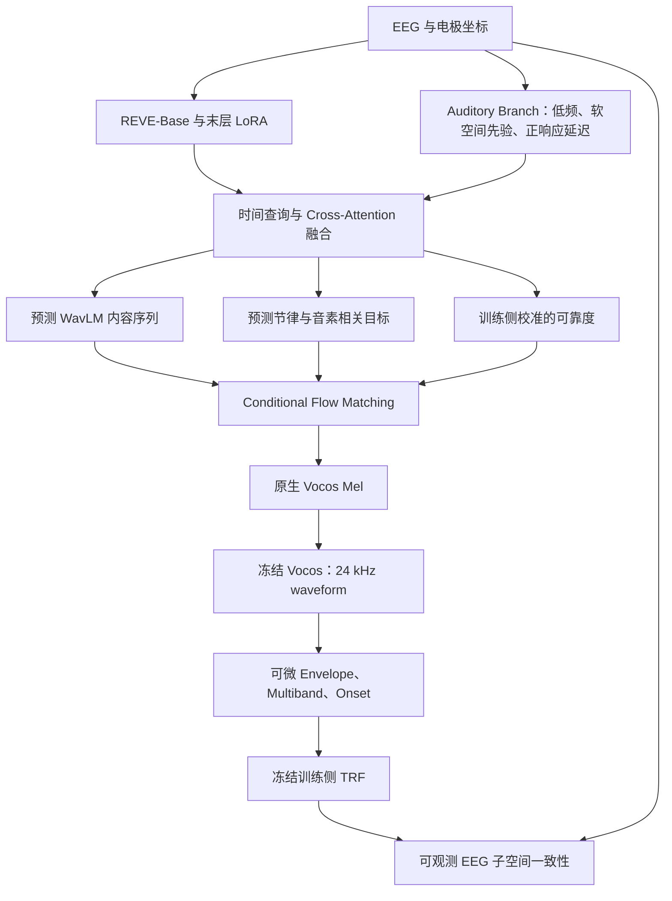

# EEG-to-Speech 研究方案改进版：NeuroSpeech

**NeuroSpeech: Physiology-Guided EEG-to-Speech Generation with Foundation Models**

研究性暂定名称，不作为最终论文标题。日期：2026-10-13；版本：`neurospeech_plan_v2.1`。

## Material Passport

- Origin Skill / Mode：academic-research-suite / experiment-agent / plan。
- 依据：用户提出的 Foundation Model、生理对齐、可靠度、Simulation 与跨被试学习要求，以及新增 Kymata 英文部分、KaraOne 和仅保留处理后数据的存储约束；项目 v1 文档及公开原始资料。
- 资料核查日期：2026-10-13。数据规模与模型接口来自下文链接的官方仓库、作者数据记录、模型配置及原始论文；训练参数与放行阈值是本项目提出的起始协议。
- Verification Status：**PLANNED / UNVERIFIED**。公开来源、Kymata 英文目录及文件体积已核查，KaraOne 官方归档已通过 HTTP HEAD 核对大小；未下载新增神经记录或媒体内容，未运行训练或数据预处理。下载后的可用配对时长、有效人数、同步误差、模型性能均待验证。
- 版本关系：本文件取代 [v1 执行方案](06_execution_plan_2026-10-13.md) 的研究范围与实验设计。现有代码仍对应单数据集 TCN 版本，不能标记为已实现本方案。

## 1. 核心问题与三个技术贡献

核心研究目标：将通用 EEG Foundation Model 适配成具有听觉任务先验的时序编码器，在同时留出语音内容与被试的条件下恢复连续英语语音，并检验跨数据集迁移。

| 技术贡献 | 要回答的问题 | 必须提供的证据 |
|---|---|---|
| Speech-specific EEG Foundation Model Adaptation | REVE 的预训练表示与听觉生理分支结合，是否比直接使用 REVE 或小型编码器更有用？ | 固定生成器下的 encoder 对照、LoRA / 生理分支消融、真实未见被试结果 |
| Physiology-guided Cross-modal Alignment | 时序、节律和音素相关监督能否产生更可用、可校准的 EEG 条件？ | 局部特征对齐、音素边界诊断、可靠度校准、正确 / 错配条件差异 |
| Neural-consistent Conditional Flow Matching | 经过独立验证的听觉前向模型能否约束生成轨迹并改善语音内容？ | 前向模型放行、完整可微轨迹、加入神经项的配对 WER 改善及条件对照 |

跨被试对抗学习与 TRF Simulation 都进入上述编码器的训练流程；它们各有固定消融，不另建独立生成架构。主生成器只使用一套 CFM，基础模型只选择 REVE-Base。

阶段一固定为 **Perceived Speech**。只有真实 EEG 条件表现出稳定的内容恢复与条件依赖后，才设计 Imagined Speech 迁移协议。本版本不把感知语音结果当作想象语音效果。

## 2. 数据固定为五个来源，按任务分阶段使用

**Perceived 阶段使用四个英语 EEG 来源：ds004408、Brennan2019、Etard 英语条件、Kymata 英文部分；KaraOne 明确进入后续 Imagined / Articulated 迁移阶段。**新增数据不新增生成器路线。

### 2.1 来源、角色与准确口径

| 数据集 | 固定来源 | 公开规模与材料 | 本项目用途 |
|---|---|---|---|
| ds004408 | OpenNeuro；沿用项目快照 `b2d91784a90c18e1d76bd77dcb2b29b0ce27a0be` | 19 人、128 通道 BioSemi、512 Hz；20 段《The Old Man and the Sea》刺激；词和音素 TextGrid | 主训练、对齐和生理监督、跨被试重建 |
| Brennan2019 | NeMAR `nm000180`；保留原始 Deep Blue 来源对应关系 | 公开版本 45 人；约 12.4 分钟《Alice in Wonderland》语音，分为 12 个刺激段；60 个头皮 EEG 通道，另有 VEOG 与 AUD；500 Hz | 四数据集联合训练；独立协议中整体留出，检验跨数据集迁移 |
| Etard EEG | Zenodo 对齐 HDF5 版本，记录号 `7778289`；原始版本 `7086209` | 英语 session 18 人、64 通道；英语 clean、lb / mb / hb、fM / fW 条件；作者转换脚本记录 EEG 为 1000 Hz | 只用英语 clean 配对训练；英语 lb / mb / hb 用于额外噪声鲁棒性评估 |
| Kymata Soto Language Dataset，英文部分 | 用户指定的 Scientific Data 论文；OSF `qdzgh` 下 `english-native-english-conversation/` | 20 名英语被试；70 通道 EEG 与 MEG 同时记录、1000 Hz；同一400秒英语对话重复呈现；已有词 / 音素时间标注 | 第四个 Perceived 来源，增加自然对话与电极布局；只用 EEG，重叠发声段按锁定标注 mask |
| KaraOne / KARA ONE | University of Toronto 官方14个分被试归档 | 14人；64通道 EEG cap、1000 Hz；7个音节 / 音素提示和4个英语词；包含提示、想象、发声阶段 | 后续 Imagined / Articulated 迁移与音系验证；按真实状态分段，不能作为连续英语听觉材料混入 P1 |

上述规模是发布规模，最终有效人数由固定 QC 决定。[ds004408 官方说明](https://raw.githubusercontent.com/OpenNeuroDatasets/ds004408/b2d91784a90c18e1d76bd77dcb2b29b0ce27a0be/README)、[Brennan2019 数据仓库](https://github.com/nemarDatasets/nm000180)、[Etard 对齐版](https://zenodo.org/records/7778289)、[Etard 原始版](https://zenodo.org/records/7086209)、[Etard 英语 session 名单](https://zenodo.org/records/7778289/files/session_info.json?download=1)、[作者转换脚本](https://zenodo.org/records/7778289/files/align_data.py?download=1)。

新增来源：[Kymata 原始论文](https://www.nature.com/articles/s41597-026-06579-8)、[Kymata 官方数据](https://osf.io/qdzgh/)、[KaraOne 官方说明与归档](https://www.cs.toronto.edu/~complingweb/data/karaOne/karaOne.html)。Kymata 的英文材料为多名说话人的连续对话，单声道文件不等于单说话人；加入主训练前需确定重叠发声 / 无法可靠对齐的 mask，保留正常轮流发言段。KaraOne 的有效头皮导联数按文件核对，不将64通道cap误写成所有文件固定64个有效 EEG 输入。

**人数和重复呈现次数不能等同于独立语音增加。**Brennan 的45人重复听约12.4分钟材料；Kymata 英文也只有同一400秒对话。四个 Perceived 来源名义人数合计102，KaraOne 另14人，最终各阶段有效人数单独报告。Kymata 的 `sub-E3b` 是 E3 的第二会话，归入同一人，不能计为第21人或跨被试fold。主结果使用单次呈现的 EEG，同一内容各次重复在同一内容split内，统计以被试为单位。

Etard v2 明确区分英语与 Dutch session。本轮排除 Dutch、Dutch 中嵌入的英语片段及双说话人 fM / fW；lb / mb / hb 按对齐版的 babble-noise 条件解释，不自行替换成一般的高斯噪声或统一 SNR。

### 2.2 分批下载、配对审计与处理后保留

每个来源生成不可变 acquisition manifest：来源 DOI / Git revision、文件 checksum、真实 EEG 通道及类型、采样率、单位、电极坐标、刺激文件、条件、时间映射、标注来源与许可。REVE、WavLM、Vocos、Whisper、音素对齐工具的权重和代码也须锁定完整 revision，写入可跟踪的小型模型清单。原始包仅作为临时处理输入，核验通过后按2.4节删除；来源manifest与必要小型元数据永久保留在processed目录。

同步审计必须按 recording 完成：

1. **ds004408：**官方说明明确声明 EEG 与刺激起点已对齐，可将零偏移作为有来源的初始值；仍须保存 run 与 WAV / TextGrid 的对应证据、持续时间核验和可用事件核验。不能仅在配置里写 `offset=0`、`drift=0` 就把逐 run 审计标成完成。
2. **Brennan：**利用 AUD 与真实 WAV 做音频同步核验，并对照逐词 `events.tsv` 的 EEG 时间轴与 `stim_file`。该重发布版连续 `.vmrk` 不保留原分段触发，不能假设从 `.vmrk` 就能恢复全部起点。[官方说明](https://github.com/nemarDatasets/nm000180)
3. **Etard：**使用作者已对齐的 HDF5，复核条件、part 与 WAV 对应；英语 lb / mb / hb 在语音前后各有一秒噪声，按发布说明剔除这两端，记录音频时间原点的相应平移。[对齐版说明](https://zenodo.org/records/7778289)
4. **Kymata 英文：**限定OSF的 `english-native-english-conversation/`，只取 `sub-E*/meg/*_task-en_*` 的 FIF / events / channels / coordsystem及英语 audio / phoneme / word 标注。使用 `STI101` 的 audio repetition触发及发布的时间修正核验每个400秒区间；触发、EOG、ECG及MEG不进入编码器。处理时从混合 FIF 中选取EEG，并保存其坐标 / 时间映射。[英文文件大小与路径审计](dataset_storage_audit_2026-10-13.json)
5. **KaraOne：**保存 `epoch_inds.mat`、`ID.txt` / `ID_p.txt` 的有效提示顺序与trial状态，对齐 CNT EEG 和对应发声 WAV；imagined区间不能与后续真实发声波形当作严格同步的 EEG–Audio 对。EEG-only任务不下载或不解包保留 Kinect 3D / animation 媒体。

可测量的同步残差以 10 ms 为目标上限，异常记录隔离审计。只有来源声明而没有监测信号的记录标为 `source-aligned`，有独立测量证据的标为 `measured-aligned`；两者都保留证据等级。偏移与漂移只能由来源和同步信号确定，不能用测试集模型分数反推。

**AUD、Sound、MIC、EOG、EMG 和 STIM 不进入 EEG Encoder。**先读通道类型再选头皮 EEG；监测音频进入编码器会形成直接音频泄漏。同步信号与事件只能用于配对 / QC。

单位修正按数据来源分别审计。现有 ds004408 的数值尺度修正及绝对 µV 解释限制沿用 [单位审计](dataset_unit_audit.json)；不得把其 `1e-6` 修正复制给 Brennan 或 Etard。

### 2.3 四个 Perceived 来源共享的内容身份

先建立 `content_registry`，再建立 split。内容身份包括 canonical audio 时间轴、作品 / passage、narrator、文本和重复版本，而不是单纯使用文件名。

- 对解码、单声道、统一采样率后的 WAV 校验；检查重采样版本、音量变化、重复片段和文本重叠。
- 同一 clean 语音及其 noisy 版本共享 content ID；不同被试听同一材料也共享 ID。
- 跨数据集的相同 passage 进入同一内容组，尤其核对英语有声书材料是否有重叠。
- 自动相似度用于筛查，重复映射须保留原始证据；普通短语相同不直接把整个故事合并。
- **Etard 是否跨条件重复使用相同语音，当前尚未下载核验。**训练前必须导出 clean ↔ lb / mb / hb 的对应表，而不是预先认定它们独立。
- Kymata 英文同一时间片的全部 repetitions / E3第二会话共用内容ID；不能把另一重复的相同声音划到测试作为未见内容。
- KaraOne 单独使用 prompt / trial / state 身份登记，重复提示和同一trial的子窗不跨split；不与连续语音的内容组混用。

如果发现训练材料与测试材料重复，必须在正式训练前修订 split 并说明原因；不能在获得测试结果后移动内容组。

### 2.4 数据体积、磁盘预算与只保留处理后的数据

以下统一采用十进制 **GB=10^9 bytes**。下载总量、处理时峰值、最终保留量是不同口径；未实际预处理的大小明确标为估算。

| 来源 | 原始下载体积与证据 | 本次使用范围 | 最终processed数据预算 | 临时周转占用（另加5 GB余量） |
|---|---|---|---|---|
| ds004408 | **20.083 GB**；本地1946文件acquisition清单求和，EEG占19.436 GB | 19人、20个英语刺激 | **10–11 GB，估算** | 逐recording约1–2 GB额外占用，不同时保存完整原始与完整processed副本 |
| Brennan2019 | **约3.8 GB**；NeMAR/EEGDash目录规模，非逐文件实测 | 45人、EEG / AUD同步与12个音频段 | **2–3 GB，估算** | 逐人约1–2 GB额外占用；原始AUD核验完成后只留同步记录 |
| Etard | **约21.1 GB**发布包：eeg.zip约19.2 GB、audiobooks.zip约1.9 GB | 只留英语clean、lb / mb / hb的processed EEG / audio | **3–8 GB，估算** | 若必须下载整包，额外预留约25–30 GB；逐个HDF5成员处理，不完整解包全部语种 / 条件 |
| Kymata 英文 | **117.767 GB**：已逐文件统计英语任务FIF及选定audio / sidecars；其中81个混合FIF为117.609 GB，最大单文件**1.616 GB** | 严格限定英文目录与task-en；只保留EEG | **5–6 GB，估算** | 按单个run下载→处理→删除，周转约3–4 GB；不将117.767 GB同时落盘 |
| KaraOne | **24.824 GB**：官方14个tar.bz2的HEAD Content-Length求和；最大单包**2.406 GB**；官网概述约24 GB | 仅EEG、所需WAV、prompt / trial / state / electrode元数据 | **2–3 GB，估算** | 每次一个被试包，建议约4–8 GB；选择性解包CNT / 标签 / WAV，跳过Kinect大文件 |

证据：[本次存储审计清单](dataset_storage_audit_2026-10-13.json)、[Brennan目录体积](https://eegdash.org/api/dataset/eegdash.dataset.NM000180.html)、[Etard官方文件大小](https://zenodo.org/records/7778289)、[KaraOne官方分包](https://www.cs.toronto.edu/~complingweb/data/karaOne/karaOne.html)。Kymata体积来自OSF英文目录的公开文件元数据，不包括俄语、MRI、视觉帧、empty-room与纯MEG校准文件；它不是整个OSF项目的大小。

**Kymata英文下载白名单已经核对：**根路径为 `english-native-english-conversation/`；公开目录包含 `sub-E1`–`sub-E20` 和 `sub-E3b`；保留所有英文task-en逻辑run所需FIF及小型sidecars、`stimuli/audio/` 的声音和文字标注。黑名单为 `russian-native-russian-conversation/`、`anat/`、`stimuli/visual/`、`task-emptyroom`、MEG校准文件。不使用“下载整个项目后删俄语”的方式。

FIF同时封装EEG与MEG，服务器文件层面不能靠选通道只下载EEG字节；必须临时读取所选英文FIF，提取EEG后删除源FIF。若某个逻辑run有split文件，先核对完整分片集合再处理，周转大小按该run所有分片求和。

processed体积估算采用以下基准：保留200 Hz float32 EEG与64 Hz float32低频EEG，持续时间为T、有效通道为C时，数组上界约为 `T×C×(200+64)×4 bytes`，再加共享audio / 标签 / receipt。ds004408按原始EEG字节及264/512率比估出约10.02 GB；Kymata按发布时长与70通道估约4.9 GB，预留为5–6 GB。KaraOne的Imagined阶段无需保存听觉TRF目标，因此可只保留200 Hz基准EEG。QC、裁剪与无损压缩可减少体积，但不预先保证压缩比；Etard需处理首个英语被试后重新测算。

**长期只保留这些处理后材料：**

- `data/processed/neurospeech/{dataset}/base/`：来源单位已校准、固定滤波 / 重采样后的连续EEG或有支持区的trial shards；物理单位保存，不按fold复制，也不提前混入测试统计。
- 英语声音每个canonical内容只保留一份可用于目标和评分的24 kHz单声道无损processed音频；需要的clean / noise声音分别登记。16 kHz teacher输入按需重采样，不另存全套重复WAV。
- 原始事件的必要小型副本、trial / state / split / 内容身份、通道 / 坐标 / mask、标注及质量、时间变换、源文件URL / revision / SHA256、预处理参数和processed SHA256。
- 所有60秒校准块在原始输入仍存在时**单独在预算内处理**，只使用该60秒的滤波 / 上下文；保存专用processed calibration shards。不能在删除raw之后从借用了区间外信息的全run滤波结果切出60秒，声称满足校准预算。

**执行清理顺序：**先冻结处理参数与内容 / 校准区间；逐个run或被试包下载并校验；在临时目录处理；重新打开输出核对形状、通道、时长、时间映射、有限值、同步 / QC、音频与标注对应；确认正式读取器能只依赖processed读取样本；原子发布processed与receipt后，立即删除该批压缩包、原始CNT / FIF / EEG / HDF5、无用媒体与临时中间数组，再继续下一批。失败时保留当前批源输入和错误记录，修复后才清理，不能留下空processed却删了唯一输入。

此处的核验只检查数据合同和预处理，不运行训练或打开模型的最终测试效果。小型源metadata保留属于可复现记录；大体积原始采样不永久留盘。以后改变滤波 / QC等源处理，需要按receipt重新下载对应源文件。

现有已校验的ds004408原始文件可直接进入这一逐批流程，无需重新下载；在v2.1的processed读取合同和专用校准块核验完成后再逐批释放。当前v1依赖raw的命令必须先迁移，不能直接删掉raw后继续沿用旧入口。

**缓存和模型也限制磁盘占用：**1–8 Hz听觉分支输入从processed基准信号按支持区在线派生，不再存第三套完整EEG；切窗只存索引，不复制重叠EEG窗；WavLM / Mel只按唯一内容与crop ID缓存，所有被试共享；P1/P2、fold和OOF共享只读processed基准，拟合统计与checkpoint分别隔离。REVE大token缓存采用上限LRU或不落盘，不生成18个完整数据副本。

不确定性OOF仅保存每帧误差汇总、预测方差及样本ID，不保存全部768维预测副本；TRF covariance流式累计，Simulation残差block按需从processed神经目标与相应OOF前向模型计算，缓存设硬上限，不按fold / seed复制完整残差EEG。这些限制必须进入读取器与缓存实现，避免处理后数据变小而衍生缓存再次占满磁盘。

五来源processed数据合计预算 **约22–31 GB**；Perceived四来源先占约20–28 GB，KaraOne到迁移阶段再下载。共享teacher缓存上限2–4 GB、公开权重约3–5 GB、主模型 / 当前resume checkpoint预算4–6 GB，试听与报告约1–2 GB，长期工作集计划约**32–48 GB**。这些模型 / 缓存数值是预算，需要首批实测更新。

按上述逐批模式，Kymata不会增加118 GB常驻占用。Etard整包路径仍可能把峰值推到约60–80 GB；若服务器支持可靠的ZIP Range读取，可只取目标成员降低峰值，否则必须预留整包空间，不能假称能按英语条件下载部分eeg.zip。每批下载前要求可用空间≥该批源包+所需解包成员+新processed输出+至少5 GB余量；不足则停止该批，不启动全量并发下载。目录清理日志记录实际释放量。

完成后raw临时目录为空，常驻数据仅为processed基准 / 标签 / provenance；可再生teacher与REVE缓存按预算淘汰。完整REVE预训练权重只保存一次；checkpoint只存LoRA与新增模块，已完成运行保留best与指标，optimizer只留当前需要resume的少数运行。

## 3. 两个实验协议，各自训练与冻结

### 3.1 P1：四个 Perceived 数据集联合训练，内部双重留出

ds004408、Brennan2019、Etard clean 和 Kymata English 联合训练，使用干净英语、单个说话人活跃的可对齐声音片段；Kymata允许正常轮流发言，可靠标注的重叠声音段排除主训练。四个来源采用固定内容划分和五个被试测试fold。

**内容划分：**优先按完整刺激段分组，约 70% / 15% / 15% 分为 train / validation / test，每个来源至少保留一个验证和测试内容组。小规模来源按整数组调整并报告实际比例；不为了凑比例切成随机相邻窗口。ds004408 在跨来源去重不产生冲突时保留 audio01–14 / 15–17 / 18–20；Brennan 与 Etard 的具体 ID 在数据审计后以固定 seed=20261013 生成并冻结，本文件不冒充已检查过其全部文件。

Kymata仅有一段400秒声音，按canonical音频时间建立固定约60秒内容block，并在边界保留完整guard；全部被试 / repetitions / E3第二会话沿用同一block split。词、音素与speaker-overlap mask也在该时间轴登记，不能以不同重复run作为不同刺激。

如果一个来源的 canonical 刺激过少，使用预先定义的连续内容 block，而不是随机切窗。block 边界两侧排除至少 10 秒；完整滤波、REVE 全窗口注意力、teacher 上下文和声学标注的支持区均须属于同一 block。报告此时评估的是同一故事中的未见片段。

**被试划分：**ds004408的sub-001–003、Brennan的5人、Etard英语session的2人、Kymata英语的3人固定为开发验证人；后三组按真实名单与固定seed生成。Kymata将E3b合并至E3后再划分，同一人的全部会话 / runs / repetitions不可跨fold。其余人按来源均衡分为五组；当前fold排除开发人和测试人。

| 用途 | 被试 | 内容 |
|---|---|---|
| 正式拟合 | 当前 fold 训练人 | train 内容 |
| checkpoint /超参数选择 | 固定开发人 | validation 内容 |
| TRF 生理放行 | 当前 fold 训练人 | validation 内容；只评分 |
| 最终主测试 | 当前 fold 测试人 | test 内容 |

每名非开发被试只贡献一次自己的 held-out 结果。所有标准化、可靠度校准、TRF、残差模型、中心被试选择和模拟噪声统计仅来自当前 fold 的训练部分。

### 3.2 P2：Brennan2019 整体外部留出

P2使用ds004408 + Etard clean + Kymata English训练，Brennan整体不参与开发。源侧训练 / 开发划分沿用固定内容规则；源侧全部非开发被试用于训练，不运行五个目标侧fold。KaraOne不进入此Perceived协议。

**P2 必须从原始公开预训练权重重新建立独立流水线。**P1 已经训练过 Brennan 的 encoder、CFM、oracle、TRF、可靠度校准器和统计量都不能拿来初始化 P2。语音 oracle 也只用 P2 源侧训练音频；外部评估前不使用 Brennan 目标音频预训练生成器。

外部测试包含两种预先声明的结果：

- **Zero-shot：**全部通过 QC 的 Brennan 被试使用冻结源模型、源侧缩放统计和真实 montage。不能拟合 Brennan 全 session 的均值、方差、可靠度、TRF 或重新选择模型。
- **60 秒监督校准：**每人只用预先指定的 60 秒连续 EEG 及对应已知语音更新小型 Adapter。全体目标被试的最终测试排除同一 calibration 内容池及其上下文 guard，使两种结果在相同测试内容上比较。校准池由元数据确定，不能按结果挑选。

外部测试的所有阈值和 Adapter 设置在源侧开发集锁定。先完成 P2 源侧开发并锁定公共架构、损失和停止规则，再进行包含 Brennan 的 P1 开发；不能把在 P1 Brennan 上观察到的效果反过来用于选择 P2 配置。缺少完整 calibration block 的被试仍进入 zero-shot，few-shot 报告缺失。Brennan 只有一个故事的有限材料，外部成功支持一次独立实验室 / 语料迁移，不能等同于任意故事、语言或 narrator 泛化。

还须审计 REVE 等公开预训练的语料重叠。如果无法排除 Foundation Model 在无标签预训练阶段见过目标来源，应明确写作“下游训练整体留出，预训练重叠未知”，不能宣称目标 EEG 从未被任何预训练模型见过。

### 3.3 Etard 噪声评估

固定评估英语 lb / mb / hb，目标为对应的 clean attended speech。各噪声版本共用内容身份、被试 fold 和 split；训练只用 clean。有对应 clean EEG 时做同被试 / 同内容的 clean→noise 配对差异，否则按缺失报告。

分别标注“训练见过内容的噪声迁移”和“测试内容的噪声迁移”，后者是主要鲁棒性结果。噪声条件不用于训练、checkpoint 选择或 SNR 特定适配。报告原始条件标签与可核实的 SNR；不猜测 lb / mb / hb 的数值。

评分同时列出 clean target 与实际呈现的 noisy waveform 的自由ASR，说明听觉输入自身的可懂度；这两类声音只进入离线评分，不进入EEG条件推理。

## 4. 共同时间接口与预处理

| 对象 | 固定起始设置 |
|---|---|
| EEG 主输入 | 来源单位审计；头皮 EEG；有效导联 CAR；0.5–40 Hz；重采样 200 Hz |
| 听觉分支 | 从同一物理 EEG 提取 1–8 Hz，保留真实时间原点；重采样 200 Hz |
| TRF / neural target | 主信号另作 15 Hz 低通，重采样 64 Hz |
| EEG 布局 | 使用真实坐标或有来源的标准montage；Perceived来源保留C=128 / 60 / 64 / 70，具体有效导联按文件核对 |
| 标准化 | 以来源平衡的训练 EEG 拟合共享缩放统计；跨布局使用共享标量尺度，不能需要新布局的测试通道统计 |
| 核心声音窗口 | 4 秒；训练 stride=2 秒；验证 / 测试 stride=4 秒 |
| EEG 上下文 | 音频核心 [a,a+4] 对应 EEG [a−1,a+5.5]，200 Hz 下为 1300 点 |
| Audio teacher | 16 kHz，音频 crop [a−1,a+5]；保留核心内 WavLM 帧 |
| 生成声音 | 24 kHz，Vocos 原生 100-bin log-Mel；固定 4 秒 |
| 边界 | 默认 guard≥10 秒；实际 FIR / resampling 支持更长时扩大并重新记录 |

使用离线 zero-phase FIR；每个 kernel、重采样器支持长度和边界扩展方式都写入 preprocessing manifest。按内容 block 独立处理，边界反射不能借用另一 split 的真实 EEG。REVE 可以看完整 6.5 秒 crop，因此即便存在正响应延迟窗口，这仍是离线重建，不能称实时。

QC 起始阈值沿用：4 秒核心内 flat std<0.1 µV、peak-to-peak>400 µV 或非有限值标为异常；异常导联超过 10% 拒绝窗口；训练拒绝率超过 20% 先进行来源单位与记录格式审计。阈值需要在训练侧确认单位解释后锁定，不能对测试数据放宽。现有坏导标注始终生效。

对 REVE 使用有效电极及相应坐标：不同布局分 bucket；坏导集合不同的样本可独立 microbatch 并累积梯度。不得把 AUD、缺失电极或坏导填成“真实有效电极”。如实现 padding，attention mask 必须真实进入 REVE 的注意力运算，而不只在输入端乘零。

每个样本保存原始 EEG 样本范围、音频范围、时间变换、内容 ID、被试 ID、条件、通道 mask、坐标来源、标注置信度、split 和全部版本。输出有效人数、独立音频时长、接受 / 拒绝窗口数及不同来源的权重。

## 5. 模型：REVE + Auditory Branch + 同一 CFM

真实音频只在训练和离线评分中提供 WavLM / 声学 / 音素目标。推理接口只接收 EEG、真实电极位置、mask、固定窗口长度、模型和噪声种子。

### 5.1 Speech-specific REVE Adaptation

主干固定 `brain-bzh/reve-base`，约 69.2M 参数，200 Hz 输入。作者公开配置为 22 层、hidden=512、patch_size=200、patch_overlap=20，故原生 patch 覆盖 1 秒、步长为 0.9 秒；输出保留 `[B,C,N_patch,512]` 的通道 / 时间结构，禁止全句平均后假装恢复高时间分辨率。[模型卡](https://huggingface.co/brain-bzh/reve-base)、[官方配置](https://raw.githubusercontent.com/elouayas/reve_eeg/main/hf/reve-base/config.json)、[官方 forward](https://raw.githubusercontent.com/elouayas/reve_eeg/main/hf/reve-base/modeling_reve.py)

先冻结全部 REVE 权重训练时序读出；随后仅在最后 4 个 Transformer block 的 attention `to_qkv` 与 `to_out` 插入 LoRA，rank=8、alpha=16、dropout=0.05，冻结原始权重。官方实现使用融合 QKV 投影，因此要按真实模块接入 LoRA，不能套用不存在的 `q_proj` / `v_proj` 名称。

将 patch 的真实中心时间与原始电极坐标一起送到 temporal readout。50 Hz 查询从邻近 patch tokens 读取信息，并与 Auditory Branch 的细粒度序列融合；细粒度信息主要来自后者，不把 patch 插值解释为新的 20 ms 神经观测。所有坐标转换遵循已锁定 REVE 的坐标约定，保留实测 / 模板位置的区别。

REVE 的预训练与本项目的 speech-specific adaptation 分开命名。本项目不以这几个有限语料重新训练一个通用 EEG Foundation Model。

### 5.2 Auditory Physiological Encoder

固定一个轻量分支，hidden=128，时间主干为 6 个双卷积残差 TCN block，kernel=3、dilation={1,2,4,8,16,32}，LayerNorm、dropout=0.1。

- **低频语音追踪：**输入 1–8 Hz EEG，保留与包络 / 节奏相关的变化。
- **响应延迟：**在音频时刻 t 查询 EEG 时刻 t+δ，δ={0,50,100,200,300,500} ms；权重为训练学习的 softmax。此窗口表示刺激后的响应，不能使用 t−δ 的相反符号。
- **软空间先验：**用电极到 Fz、Cz、T7、T8、POz 模板位置的距离构造 attention bias；强度从小值初始化并可学习。全部有效头皮电极仍可被选择，不把头皮坐标当作精确听觉皮层定位。

在 200 Hz 下该 TCN 理论感受野为 253 点，约 1.265 秒；右侧 1.5 秒上下文覆盖其半感受野和最大 0.5 秒响应延迟。额外融合层必须检查是否扩大所需上下文。

### 5.3 融合与时序 heads

固定采用 **Auditory 时间查询 → REVE tokens 的 Cross-Attention，再作 gated residual fusion**，融合宽度 256、4 heads、2 层。它同时保留预训练上下文与局部听觉序列，不能简单平均两个分支。

融合后输出：768 维 WavLM 均值序列、envelope / onset 节律序列、音素边界及音系特征概率、内容 / 节律两类可靠度。音素 head 只作辅助监督，生成时不输入目标音素串或真实时间戳。

相关 2026 speech benchmark 比较的是 LaBraM / EEGMamba 与 CNN，任务为 overt / imagined 分类；它没有直接检验 REVE 或本项目的 perceived 连续生成。因此仅把它作为“预训练迁移需要验证”的动机，不能据此宣称 REVE 已被证明无效。[原始 benchmark](https://arxiv.org/abs/2607.27268)

## 6. 多层次 Neuro-Acoustic Temporal Alignment

### 6.1 固定语音目标

1. **WavLM：**冻结 `microsoft/wavlm-base`，第 6 个 Transformer block 输出，768 维，16 kHz 音频。卷积 stride=320、感受野=400 样本，名义帧间隔 20 ms；帧中心由实际卷积参数计算。[官方配置](https://huggingface.co/microsoft/wavlm-base/blob/main/config.json)
2. **Envelope / onset：**25 ms RMS、正部相邻帧差分，64 Hz。另提取 8 个固定频带的平滑 envelope，服务于 TRF；不另训练声学 teacher。
3. **Phoneme-related targets：**优先使用 ds004408 的已有 TextGrid；Brennan / Etard 使用来源文本和同一冻结英语 forced aligner，统一映射为音素边界与固定音系特征表。

新标注工具固定为 MFA `english_us_arpa` acoustic / dictionary 配对，版本与文件 checksum 写入 manifest；不同英语口音需质量检查。[MFA 官方用法](https://github.com/MontrealCorpusTools/Montreal-Forced-Aligner/blob/main/docs/source/first_steps/index.rst)、[模型适用范围](https://huggingface.co/MontrealCorpusTools/english_us_arpa)

不能假设 Etard 已提供完整可用文本：先检查来源，缺失部分建立经核对的 transcript。自动 ASR 可用于初稿，但最终 WER reference 不能直接取自同一个评分 ASR 的输出。新音素标注在训练 / 开发侧按来源各抽取至少 200 个边界检查，报告误差分布和有效覆盖率；低质量区间 mask phoneme loss。测试标注只用于锁定后的评分，不能训练或选择模型。

### 6.2 对齐损失

\[
\mathcal L_{\mathrm{align}}=
\mathcal L_{\mathrm{feature}}+0.1\mathcal L_{\mathrm{contrast}}
+0.2\mathcal L_{\mathrm{rhythm}}+0.05\mathcal L_{\mathrm{phoneme}}.
\]

- `L_feature = SmoothL1(μ,H_A) + 0.5·(1−cosine(μ,H_A))`，使用训练音频逐维缩放统计及 valid-frame mask。
- `L_contrast`：1 秒局部表示的 symmetric multi-positive InfoNCE，temperature=0.07。相同内容 / 时间的多被试 EEG 是正样本；重复内容及重叠邻窗不能成为负样本；负样本按内容与时长匹配。
- `L_rhythm`：标准化 envelope / onset 的 MSE，加 envelope 的 `1−Pearson r`；有效变化接近零时只计算回归项。
- `L_phoneme`：音素边界 weighted BCE，加音系特征 BCE；权重 / 类别统计来自训练侧，按标注质量 mask，不把 word-level onsets 伪装成可靠 phoneme 真值。

所有项先按有效帧 / 特征数平均。上述权重是起始值；记录真实样本上的梯度范数，源侧开发期最多进行一次预先记录的量级调整，然后冻结所有系统的可比设置。不能将未经归一的四个 loss 数值直接比较大小。

## 7. Reliability-aware Conditioning

每个时间片输出语音特征均值 μ_t，以及内容 / 节律各一个 log-variance s_t。可靠度 head 输入融合表示，但误差目标由训练侧预测误差提供，推理时不能输入真实音频特征、残差或目标文本。

采用 detach 的标准化预测误差监督不确定性：

\[
\mathcal L_{\mathrm{var}}=\tfrac12\left[
e_t\exp(-s_t)+s_t\right],\quad
e_t=\operatorname{stopgrad}\left(\operatorname{mean}_d(\mu_{t,d}-H_{A,t,d})^2\right).
\]

节律分支使用同样定义。对 head 输入 stop-gradient，避免不确定性目标反向改写内容表示；方差限制在 [1e−4,10] 的标准化误差尺度内。

**校准必须来自训练侧 out-of-fold：**在每个正式训练集合中做三折被试 / 内容分组；第 k 个副本排除对应被试组与内容组训练，在双重留出的训练侧交叉部分预测。用这些 OOF 误差拟合单调的 log-variance 校准关系，再为全训练 encoder 固定校准器。B1 / B2 训练同时使用 `L_align+0.05L_var`；OOF 副本重复同一 B1 / B2 日程，其任何标准化、TRF、中心选择与模拟统计也须排除对应留出组。OOF 副本是校准成本，必须计入计算预算。

CFM 的输入可靠度定义为 `R=1/(1+calibrated_variance)`，内容与节律分别 gating。训练 / 推理都使用同一 EEG 可计算的 head；不能训练时使用真实误差 gating、测试时换成预测误差。

可靠度检查报告误差排序相关、校准曲线、risk–coverage 和不同来源分层结果，并与常数方差比较。开发放行要求被试分组 bootstrap 的方差–误差 Spearman 相关 CI 下界>0，且 Gaussian NLL 优于训练侧常数方差；不满足则冻结为中性 gating 并报告失败，不允许用它屏蔽难例来改善整体指标。

生成阶段冻结已对齐的 encoder、heads 与校准器，保持可靠度对应的误差分布。所有生成端训练只更新 CFM；这样 S2 / S3 的条件保持完全相同，主要对比可以直接检验 NC。60 秒 Adapter 会改变目标被试的条件分布，few-shot 的可靠度只是沿用源侧估计，须单独报告其校准诊断，不能宣称自动实现新被试误差校准。

额外条件诊断包括：正确 EEG、wrong-time EEG、null，以及在保留正确节律 / 可靠度时打乱内容条件。这能检查可靠度是否只学会音量、来源或难度。所有样本进入主要 WER，不能仅报告高可靠度子集。

## 8. Neural-consistent Conditional Flow Matching

### 8.1 同一生成器与条件接口

采用 noise→data 的线性 CFM 路径：

\[
M_\tau=(1-\tau)z+\tau M,\quad z\sim\mathcal N(0,I),\quad
\mathcal L_{\mathrm{FM}}=\mathbb E\|v_\theta(M_\tau,\tau,c_E)-(M-z)\|^2.
\]

基础公式沿用 Flow Matching，创新集中在条件与神经约束。[原始论文](https://arxiv.org/abs/2210.02747)

CFM 固定 6 层 time-conditioned Transformer、hidden=256、4 heads、AdaLN 时间注入，目标可训练参数≤15M，实际统计后锁定。所有系统使用同一网络：

- 内容条件：预测 WavLM 序列经 Cross-Attention 进入 Mel tokens。
- 节律条件：预测 envelope / onset 按真实时间插值到 Mel 网格，作为低频局部 residual modulation。
- 可靠度：分别调节上述两条信息通路，中性值的基线保持相同接口。
- 空条件：10% 训练样本同时置空内容 / 节律条件；正式推理 guidance=1。

目标 Mel 必须使用冻结 `charactr/vocos-mel-24khz` 的原生 feature extractor：24 kHz、100 bins、n_fft=1024、hop=256、center padding；采用幅度 Mel 的 natural log。训练侧拟合 Mel-bin 缩放，解码前恢复；4 秒通常为 376 帧，以原生前端形状为准。[Vocos 配置](https://huggingface.co/charactr/vocos-mel-24khz/blob/main/config.yaml)、[原生前端](https://github.com/gemelo-ai/vocos/blob/main/vocos/feature_extractors.py)

正式采样固定 32 步 Heun，生成种子 0、1、2，在窗口内平均指标，不挑最好样本。初始状态是纯噪声，推理不需要真实 Mel、WavLM、文本、词数或真实句长。

**固定音色条件的操作定义：**所有样本使用同一个可学习 style token，维度 128；只在对应协议的训练音频 oracle 阶段学习，之后冻结。该条件不依赖被试或测试声音。本轮仍以真实 native Mel 作为监督，因此固定 token 本身不能保证所有输出已转换为同一 narrator；把“条件固定”与“实际音色完全一致”分开报告。主要终点是内容，不把额外 speaker similarity 当成功门槛。

可借鉴 NeuroSonic 的 time-conditioned generator / ODE 设计，其官方代码与 checkpoint 已发布；预训练模型的特征接口、训练来源与本项目不同，不能未经兼容性 / 重叠审计就直接当作本轮 oracle。主实验统一使用本协议训练音频训练的 oracle 初始化。[MICCAI 论文](https://papers.miccai.org/miccai-2026/0711-Paper4295.html)、[作者代码](https://github.com/Y-Research-SBU/NeuroSonic)、[公开 checkpoint](https://huggingface.co/Y-Research-Group/NeuroSonic)

### 8.2 听觉 Forward Model 与可观测子空间

对每个来源、当前 fold 的每名训练被试单独拟合：

\[
F_s(\phi(A))(t)=b_s+\sum_{\delta=0}^{500\mathrm{ms}}W_{s,\delta}\phi(A)(t-\delta).
\]

输入 φ 为 broadband envelope、8-band envelope 与 onset，全部在 64 Hz 上；输出为该被试的低频 EEG。频带边界、包络平滑和缩放只由训练协议确定。

采用 mTRFpy ridge 拟合，lag=0…500 ms，λ 候选={0.01,0.1,1,10,100}；锁定包版本及其 ridge 缩放 convention。嵌套分组 cross-fitting：内层选择 λ，外层产生真正未拟合过对应内容的预测，用于选择 P_s 和估计残差，不能在同一 OOF 输出上反复调 λ 再声称独立验证。[mTRFpy 官方说明](https://mtrfpy.readthedocs.io/en/stable/basics.html)

内容组不足时，TRF 的训练内部使用带 guard 的连续 60 秒 block；这只在 train 内容内部发生，不改变主 train / validation / test 划分。

`P_s` 固定为训练 OOF 确认可预测的通道子空间：r>0、500 次≥2秒循环移位对照、拼接边界 mask、BH-FDR q<0.05；最多 32 个通道。训练 OOF 残差在该空间估计 shrinkage covariance Σ_s，特征值下限为标准化方差 0.1。P_s、Σ_s、λ 与 TRF 随后冻结。

独立放行目标沿用：每个来源至少 80% 的训练被试拥有≥8个合格通道；未见 validation 内容上的被试中位平均 r≥0.05，正确对应相对时移 / 错配的被试配对优势 95% CI 下界>0。这些是本研究门槛，不是已取得结果。

不合格人的 neural loss mask 为零，但继续参与真实 EEG 对齐 / FM 训练。某个来源整体失败时，报告该来源神经项覆盖为零，不把它隐藏；S2 的内容对齐实验仍可完成。是否满足四来源完整神经约束主张，由实际放行覆盖决定。

### 8.3 神经项必须约束完整生成轨迹

\[
\hat A=\operatorname{Vocos}\left(\operatorname{denorm}
(\operatorname{CFM\_rollout}(z,c_E))\right),
\]

\[
\mathcal L_{\mathrm{NC}}=
\operatorname{mean}_{\mathrm{valid}}
\left[P_s(F_s(\phi(\hat A))-E_{\mathrm{low}})\right]^T
\Sigma_s^{-1}
\left[P_s(F_s(\phi(\hat A))-E_{\mathrm{low}})\right].
\]

φ 采用可微 RMS / onset / multiband 运算，其滤波与 NumPy / mTRF 拟合前端必须数值对齐。比较真实核心 EEG 的 0.6–3.9 秒有效区域。

遇到窗口坏导时，只用 `P_s` 与窗口有效通道的交集，并取对应残差covariance子矩阵后求逆；不能先对白化的完整向量乘mask。少于4个有效合格通道时，该窗口NC项置零；按有效时间与维数归一，并报告实际触发覆盖率。

每 4 个普通更新，从合格训练被试取 microbatch=1，以独立纯噪声开始，用 8 步 Euler 完整 rollout；activation checkpointing 控制显存。λ_NC 在 CFM 训练第 5k–10k 更新由 0 增至 0.1，之后固定。内容、节律和可靠度均 detach，普通 FM 与额外 NC 分支都只更新 CFM；编码器已在 B1 / B2 完成适配。

冻结 Vocos 参数不等于禁用输入梯度。训练 wrapper 直接调用冻结 backbone / head，绕过作者 decode 的 inference-mode 包装；不 detach Mel，不对整条链使用 no_grad。必须核对 `NC→waveform→Mel→CFM` 梯度非零、有限，冻结网络没有参数梯度。[Vocos 解码实现](https://github.com/gemelo-ai/vocos/blob/main/vocos/pretrained.py)

不能用含真实 Mel 的 M_τ 或一步反推估计计算主要神经项。记录 8 步训练轨迹与 32 步采样的开发差异；TRF 分数下降不自动等于 WER 改善。

训练测试新被试没有其训练侧 TRF。主结果不能为测试人另拟合评分器；neural consistency 指标来自“训练人 × 未见 validation 内容”的独立诊断。

## 9. TRF Simulation：只增强听觉鲁棒性

\[
E_{\mathrm{sim}}=F_s(\phi(A))+\epsilon_s.
\]

模拟器只使用当前训练人、训练音频、训练 TRF 和 cross-fitted 残差。残差按连续 block 重采样，保留时间 / 空间相关，不能替换成任意白噪声；扰动范围由训练人的增益、延迟、空间混合和已观察伪影统计限定。保存生成种子、原始来源和模拟参数。

采用真实样本 80%、模拟样本 20% 的辅助混合，simulation loss 起始权重 0.1。**模拟样本只监督节律 head 与节律表示的一致性，不参与 WavLM 内容回归、音素损失或真实 EEG–Audio 对比项。**仅把低频 TRF 合成信号与某段音频绑定，再要求其恢复完整 WavLM，会把人为的训练关联误当成真实神经语义。

真实数据承担主要内容训练；模拟数据不得来自被留出的内容，即使音频本身公开也不行。不能模拟测试人的个体 TRF。对其效果用“真实训练”和“真实 + 模拟训练”在未见真实被试上的配对消融判断。

Simulation 的保留规则固定为：三个训练种子的真实开发集、来源等权 WavLM 误差平均降低≥2%，且没有单一来源误差增加>5%。P2 的判断仅用源侧；P1 独立判断并记录不同变体。未达到则停止主模型的模拟混合，保留真实训练结果和负消融；其余模型继续，不启动新模拟架构搜索。噪声测试的改善在冻结后评估，不作为保留 Simulation 的调参依据。

## 10. 跨被试：GRL 与 centered-progressive curriculum

跨被试训练直接作用于融合后的共享 EEG 表示。SAM-Net 的 C-SA 提供方法动机，但其原始任务为 EEG-to-Video；本项目下面的语音训练日程是明确的改编，不声称已经原样复现或验证。[CVPR 原论文](https://openaccess.thecvf.com/content/CVPR2026/html/Han_Cross-Subject_EEG-to-Video_Reconstruction_and_Beyond_CVPR_2026_paper.html)

1. **先稳定内容表示：**所有训练人联合完成真实数据 alignment warmup，不加入 GRL。
2. **加入 subject adversarial head：**对融合序列作 mask-aware 时间汇总后预测训练人 ID；每个来源内部有一个 classifier，经 GRL 降低身份信息。不能把来源与 subject 一一对应的分类器当成纯 subject 去除。
3. **确定中心：**在同一来源、相同训练刺激 / 时间 anchors 上计算各训练人的表示距离，选择 medoid。不能用不同故事平均表示相似度排序，更不能使用测试人选中心。
4. **渐进组织采样：**按照到中心的距离，把中心附近25%→50%→100%训练人作为主采样池；每阶段保留20%全训练人replay，P1四来源平衡，P2仅源侧三来源平衡。中心不是唯一训练对象。
5. **GRL 日程：**在 LoRA adaptation 的前 10k 更新后启用，随后 10k 内从 0 升至 0.05。若开发 WavLM 误差连续两次验证相对启用前恶化>10%，仅允许将上限减半一次至0.025；再次触发则停止GRL并记录失败。此规则在源侧预先冻结，不能在测试后调整。

每个 batch 先平衡来源，再平衡真实被试与内容；避免 Brennan 的人数优势淹没其他来源。adversarial loss 只用于真实样本；Simulation 没有可作为真实身份标签的新被试。

Zero-shot 使用共享模型。Few-shot 仅更新融合表示后、任务 heads 前的零初始化残差 Adapter，256→16→256，约 8.5k 参数；主干 / LoRA / heads / CFM / 可靠度校准器全部冻结。

校准预算为真实连续 60 秒 EEG，滤波和模型上下文全部计入；block 内单独滤波，排除边界后使用内部核心窗。对应音频也是这 60 秒以内的已知刺激。固定 100 updates、batch=16、lr=1e−3，alignment 的 feature / rhythm / phoneme 项加 0.001 adapter 输出平方惩罚，标注缺失的项 mask；不在校准块选最好 checkpoint。

## 11. 明确训练顺序、预算与放行

训练种子固定 {11,22,33}；先以seed11完成P2源侧开发、锁定公共架构和训练规则，再完成P1/F0/11开发并冻结各协议的变体；通过后扩展矩阵。不从Brennan外部结果或P1中Brennan的效果选择P2配置。

| 阶段 | 做什么 | 冻结 / 更新边界 | 起始预算和产物 |
|---|---|---|---|
| A0 | 四个Perceived来源的元数据 / 内容登记与split，随后逐run处理；KaraOne登记为后续来源 | 不训练模型；发布processed后清理对应raw | 大小 / 同步 / 单位receipts、content registry、有效时长、split v2.1、processed-only读取合同 |
| A1 | native Mel→Vocos copy；真 WavLM + 节律→CFM oracle | audio teachers / Vocos 冻结；只训 CFM / style token | 每协议 / seed 上限 20k updates，batch=32，lr=2e−4；copy 与 oracle 音频 / WER |
| A2 | TRF 嵌套 cross-fitting 与未见内容验证 | train 人与 train 内容拟合 | P_s、Σ_s、覆盖率、放行 gate |
| B1 | 冻结 REVE，训练 Auditory Branch / fusion / temporal heads | REVE 冻结 | 10k updates，batch=32，lr=3e−4；时序对齐基础 |
| B2 | speech LoRA adaptation，随后 GRL / curriculum / Simulation | 仅 LoRA + 新模块更新 | 30k updates，LoRA lr=1e−4，新模块 lr=3e−4；10k稳定后加入辅助机制 |
| B3 | 三折训练侧 OOF 与可靠度校准 | 每副本排除指定训练组；不接触正式验证 / 测试 | OOF residuals、校准器、误差预测诊断；另计训练成本 |
| C1 | 预测条件 CFM，从本协议同种子 oracle 初始化 | encoder / heads / 校准器全程冻结 | 30k updates，CFM lr=1e−4，有效 batch=32 |
| C2 | 同一30k内，自第5k起完整系统触发NC | 普通FM和NC都只更新CFM | S2为 `L_FM`；S3另加触发式 `λ_NC L_NC` |
| D | 全矩阵冻结，主测试 / 外部 / noise / 60s | 主测试不更新；few-shot只更新Adapter | 全部样本指标、声音、统计表、负结果 |

C1 / C2 是同一段 30k 更新，不累加成 60k。所有 AdamW weight_decay=0.01、gradient clip=1、1k warmup 后 cosine decay；普通网络 BF16，TRF / φ / covariance / neural loss FP32。microbatch 起始=2，梯度累积保持有效 batch；实际 GPU 用量由开发运行测量。

OOF对18个正式S2/S3 encoder（5个P1 fold + 1个P2协议，各3seed）最多增加54个训练副本；这一开销独立列出，不能只报告72次CFM。B1可缓存冻结REVE输出；B2固定前18层可在输入不变时缓存，改变EEG增强或模拟输入时必须重新计算。生成阶段可缓存已冻结的EEG条件，减少重复Foundation Model推理。

开始实验前冻结以下门槛：

- **copy：**相同 ASR 设置下，验证 WER 相对原声音恶化≤5pp，长度误差≤1 Mel hop。
- **oracle：**每个来源验证 WER≤40%，相对该来源 copy 恶化≤15pp；某来源失败先修复语音链路，不能让其他来源平均分掩盖。
- **encoder：**各来源正确局部条件对齐优于≥10秒 wrong-time，按被试的配对优势 CI 下界>0；同时检查节律 / phoneme / reliability，分项失败单独报告。
- **基础生成：**开发正确 EEG WER 低于 wrong-time 和 null，且多数开发被试同向；否则停止正式生成扩展并审计 conditioning。
- **TRF：**按第8节门槛放行；只允许已验证来源 / 被试触发 NC。

开发人每来源只有2–5名，上述CI仅用于开发决策，不能代替正式被试泛化证据。

每 2k updates 验证一次。每来源 / 验证内容预选最多10个非重叠窗口，种子0选择 checkpoint；来源等权、被试宏平均 WER 最小，Mel MAE 只用于精确平局。encoder 阶段按来源等权 WavLM 误差选择。最终总结使用三个生成种子。

Neural / Simulation / GRL 的开发停用规则在测试前写入 model variant manifest；正式阶段不能看到测试分数再决定“最终模型”是否含某项。

## 12. 主比较与固定消融

### 12.1 只保留四个主系统

| 系统 | EEG 条件 | 训练支持 | 生成 |
|---|---|---|---|
| S0：Small Temporal | 小型 TCN，预测 WavLM 内容 | feature + local contrast，真实数据 | 同一 CFM，节律置空 / 中性 gating |
| S1：Direct REVE | 冻结 REVE + 同一宽度时序读出 | feature + local contrast，真实数据 | 同一 CFM，节律置空 / 中性 gating |
| S2：NeuroSpeech Alignment | REVE LoRA + Auditory Branch + multilevel alignment + calibrated reliability | 固定 GRL / curriculum，按开发规则保留 Simulation | 同一 CFM，无 NC |
| S3：NeuroSpeech Full | 与 S2 同一 encoder 初始化和条件 | 与 S2 相同 | 同一 CFM + 已验证 NC |

主要机制比较是 **S2 与 S3**，其数据、encoder 初始化、oracle、生成器、种子、普通更新数完全一致。S3 相对 S1 / S0 检验整个适配方案的实用价值，不能仅凭这个组合差异把贡献归因于某一组件。

P1：4系统×5fold×3seed=60次CFM训练；P2：4系统×3seed=12次，共 **72次主训练**。新增Kymata扩大同一训练集合，保持系统 / fold数量；KaraOne迁移到后续阶段单列预算。每协议 / seed共享一个oracle，共6个；S2 / S3共享B1–B3 encoder与校准器。满足冻结设置的开发运行可以复用。

### 12.2 六个定点消融，不做组合网格

| 消融 | 比较方式 | 回答的问题 |
|---|---|---|
| A1：去 LoRA | S2 encoder 只冻结 REVE，新模块同预算 | speech-specific backbone adaptation 是否有用 |
| A2：去 Auditory Branch | REVE LoRA保留，时序fusion用同宽读出；其他监督保留 | 显式听觉时序 / 空间先验是否有额外信息 |
| A3：去 phoneme supervision | 只令 phoneme权重为0 | 音素相关辅助目标是否改善内容线索 |
| A4：中性 reliability gating | 同一完整条件，移除可靠度调节 | 可校准的不确定性是否帮助生成 |
| A5：真实 vs 真实+Simulation | 其他训练机制相同 | 模拟是否提升未见真实EEG鲁棒性 |
| A6：curriculum消融 | uniform+无GRL、uniform+GRL、progressive+GRL | 分离对抗共享表示和中心渐进采样的贡献 |

A1 / A2 / A3 / A5 / A6 首先只做 encoder-level 对齐评估，使用 P1/F0 和 P2源侧开发、三个种子。A4 的生成验证、A6 的 uniform+GRL 与完整系统生成验证各增加2协议×3seed=6次，即初始额外12次 CFM；同一encoder已有结果直接复用。只有预先声明的编码器消融发现明确机制矛盾时，才申请扩大对应生成验证范围。

这些消融只修改同一模型 / 日程的一个因素；不添加第二个 Foundation Model、Diffusion、独立 Simulation 网络或新数据集。报告有限消融的 fold 范围，不能把它们写成五fold全矩阵证据。

### 12.3 所有系统的必要推理对照

正确 EEG、同被试 / 同刺激但核心相隔≥10秒的 wrong-time、训练过的 null，均共用噪声种子。Oracle 是独立语音侧模型。另对 S2 / S3 做保留节律与可靠度的内容打乱诊断。

wrong-time 对应表在训练前按样本ID确定。试听预先固定样本，每来源 / 被试 / 刺激选固定窗口，公开 original / oracle / S0 / S1 / S2 / S3 / wrong；不按重建分数选择最好例子。

## 13. 终点、统计与论文结论

**P1 唯一主要终点：S2 WER−S3 WER。**先在每被试内汇总窗口词错误率并平均生成样本，再平均三个训练seed，按来源分别作被试宏平均，最后四来源等权。固定冻结Whisper small.en，自由greedy ASR；temperature=0、不使用目标prompt或前文条件；统一英语规范化。WER允许超过100%，不能截断成“准确率”。

每个被试 / 训练seed / 生成seed的WER为全部窗口的总word errors除以总reference words，再对seed平均。比较系统使用相同有效窗口与reference；音素边界F1固定匹配容差为±50ms，不能按测试结果改变容差。

已知 narrator 的声音可能是预训练 ASR 较熟悉的分布；同时报告原始音频与copy的WER，保持所有系统同一reference、切窗和声学边界。正式评估禁止候选强制选择替代自由转写。

主要配对CI按来源内重采样被试，然后等权合并；p值用来源分层的被试符号翻转检验，规模较大时固定100k Monte Carlo。seed、窗口和三个生成样本不是独立被试。

关键次要结果：S3−S1 / S0 的内容改善、correct 对 wrong / null、P2外部zero-shot / few-shot、Etard clean→noise。预先定义检验族，次要检验Holm校正；逐来源、逐人、逐seed和缺失都公开。

同时做被试×canonical内容block两维bootstrap，报告实际独立内容组数；四来源仍不足以对“所有实验室”给出总体推断。外部Brennan和P1的同一人不能作为两名独立参与者合并。Kymata有同期视觉点刺激，记录为已知采集干扰，不将视觉特征输入模型，也不把该来源称为纯听觉环境；其单一400秒内容与重复次数限制单独报告。

辅助指标：WavLM误差 / cosine、固定20候选retrieval、phoneme boundary F1与固定容差、envelope / onset r、native Mel MAE、spectral convergence、可靠度校准、TRF验证、参数量、显存、训练 / 推理时间。它们解释机制，不能替代主要WER。

实用目标设为主要WER改善≥5pp、95%CI下界>0，S3同时优于wrong / null，并且各来源多数被试同向。该5pp是项目目标，不是公认领域标准。若只提升声学或TRF指标，结论限于节律 / 声学一致性；如果整体WER仍高，不能写成已实现可靠的连续句子恢复。

## 14. Perceived 成功后再迁移到 Imagined

启动条件：语音oracle通过；P1主要内容与条件对照有支持；P2至少显示正确EEG条件优于错配 / null，且结果不是仅由监督校准得到；Simulation / reliability / TRF机制有完整可审计记录。

**迁移数据已固定为KaraOne。**达到上述门槛后再下载其14个分被试归档；届时锁定具体Imagined协议与预处理配置，复用通过Perceived验证的语音生成器与基础EEG表示，再适配任务时间接口。它已进入整体数据计划，下载与训练阶段安排在Perceived验证之后。

KaraOne的7个音节 / 音素与4个词作为有限提示词汇；保留stimulus、imagined、articulated的明确状态与原始trial ID。主要迁移验证先报告音系特征与11类prompt的balanced accuracy / macro-F1、被试泛化，以及固定词汇下的生成诊断。各重复trial的全部子窗共用split；模型测试时不接收提示文字、真实发声声音或Kinect信息作为输入。

KaraOne按被试建立固定开发 / 测试组，zero-shot与监督校准分开；同提示词可在训练和测试出现时，结论限定为固定词汇迁移，不能称未见词汇或连续自由语音重建。Perceived的4秒核心 / 6.5秒EEG上下文只适用于第4节的听觉任务，不能直接套到仅5秒的imagined状态：迁移时序窗与滤波支持必须位于对应状态内，避免从提示声音或后续发声阶段借入信号。任何较短imagined输出接口另行锁定与验证。

处理KaraOne时只保留EEG基准 / phase shards、正确的prompt顺序、trial状态 / 时间 / mask、必要发声WAV及provenance。Kinect animation / 3D媒体不常驻；单人archive核验处理完成后删除。真实articulated EEG–Audio可作为配对辅助验证，但其肌电污染须单独报告，不与imagined指标混合。

感知任务中的声学输入、听觉TRF和0–500ms刺激响应不能直接当作想象任务真值。没有真实同期waveform时，文本驱动合成音或同trial之后的真实发声只能作为目标来源，不能包装成真实同期想象声音；有限词汇分类不能等同于自由连续重建。本阶段记录KaraOne的来源与体积，但不把其imagined数据混入Perceived主训练。

## 15. 当前项目到v2.1的实施清单

| 现有组件 | v2.1需要的修改 | 完成标志 |
|---|---|---|
| ds004408 acquisition / 单位审计 | 新增Brennan / Etard / Kymata-English reader，登记KaraOne迁移reader；保持原始checksum证据 | 四个Perceived来源manifest；KaraOne阶段 / 体积已固定 |
| 全量raw保留 | 改为下载白名单、逐批处理、processed合同核验、原始包清理；保存60秒专用calibration shards | raw临时目录清空、读取器不依赖raw、释放量可审计 |
| 128通道 / 128Hz数据接口 | 200Hz、真实可变montage、AUD排除、双协议split、共享训练缩放 | 时间 / 布局 / split合同通过 |
| TCN encoder | 保留S0；新增REVE LoRA、Auditory Branch、时序fusion、phoneme heads | 明确真实token时间轴和有效mask |
| teacher缓存 | 增加multiband / phoneme，P1/P2严格分离 | 独立训练统计及标注质量 |
| CFM内容条件 | 内容 / 节律 / reliability独立注入，固定style条件 | EEG-only完整轨迹 |
| TRF | mTRFpy嵌套crossfit、8-band前端、P_s与残差covariance | 每来源放行与梯度数值一致 |
| 新训练支持 | OOF校准、TRF Simulation、GRL / curriculum | 来源追溯、固定消融 |
| adapter / evaluation | 256维Adapter、独立P2、noise配对、四主系统统计 | 冻结后完整评估记录 |

建议物理处理基准放在 `data/processed/neurospeech/{dataset}/`，只读共享；原始输入仅在 `data/staging/neurospeech/` 周转。新协议配置仍用 `configs/neurospeech_v2/`，统计、TRF / OOF / checkpoint / protocol lock放在 `artifacts/neurospeech_v2/{P1,P2}/`，teacher缓存按内容 / 权重 / crop身份共享。KaraOne后续用独立Imagined命名空间。正式读取器只使用processed及receipts，不依赖已删除的raw路径。新命令在实现后再写入运行说明，本阶段表不代表它们现在存在。

下一次实施先完成A0：登记四个Perceived来源的全局内容、校准块和下载大小，固定处理参数后逐批生成processed并清理raw，再完成语音oracle / TRF，随后接入完整双分支encoder。Kymata仅英文，KaraOne按后续阶段下载。研究范围保持三项贡献，运行顺序逐阶段推进；每阶段提供可以审查的产物和失败解释。
